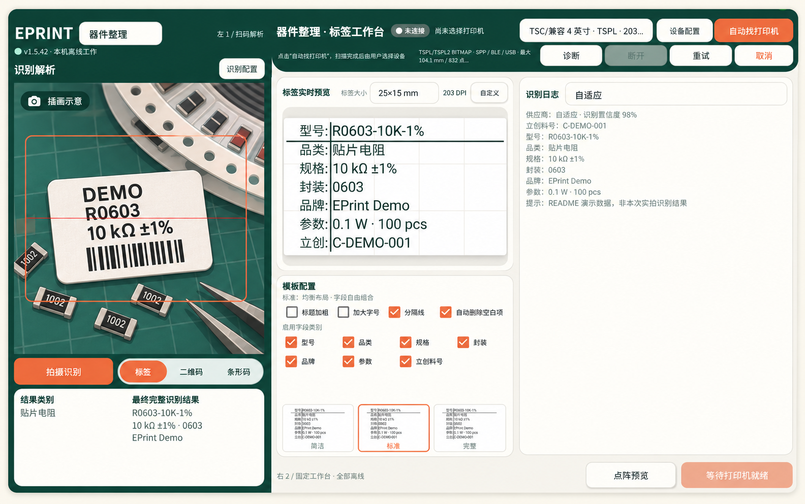

<div align="center">

# EPrint

**Android 离线标签工作台**

从器件标签识别，到字段整理、标签排版与本地打印。

<p>
  
  
  
  <a href="LICENSE"></a>
</p>

[快速开始](#快速开始) · [功能概览](#功能概览) · [打印机兼容性](#打印机兼容性) · [开发文档](#开发文档)

</div>



<sub>基于 v1.5.42 真机界面制作。摄像头区域为卡通插画，器件字段为演示数据；本图经过编辑，不代表本次实际 OCR 或实体打印结果。</sub>

## 项目简介

EPrint 是面向 Android 平板的原生标签编辑与打印应用，适用于电子元器件整理、物料标识和日常标签制作。它把摄像头输入、识别结果、标签预览和打印设置放在同一个横屏工作台中，减少录入与排版之间的反复切换。

应用不申请 `INTERNET` 权限。扫码、图像处理、模型推理、文档保存和打印编码均在设备本机完成；设备连接使用经典蓝牙、BLE 或 USB。

**工作流程：** 拍摄或扫码 → 整理字段 → 选择模板 → 检查点阵预览 → 连接设备打印。

## 功能概览

| 能力 | 说明 |
|---|---|
| 标签与条码识别 | 摄像头识别二维码、常见一维码与器件标签；支持标签提取、透视矫正和反光抑制。 |
| 器件字段整理 | 整理型号、品类、规格、封装、品牌、参数和立创料号，使用简洁、标准、完整三档布局。 |
| 标签编辑与预览 | 使用毫米尺寸和打印 DPI 定义画布，编辑、拖动内容，按设备点宽生成预览与打印点阵。 |
| 本机 OCR 与文本增强 | 内置 PP-OCR；可选 GLM-OCR 视觉识别及 Qwen3.5 文本补全与有证据约束的纠错。 |
| 打印机连接 | 支持经典蓝牙 SPP、BLE GATT 与 USB Host Bulk，提供设备发现、档案保存、任务队列和断线重连。 |
| 多协议编码 | 实现 ESC/POS、TSPL/TSPL2、CPCL、ZPL 编码，并包含针对指定设备验证的德佟 P1 私有协议路径。 |

### 两种工作方式

- **器件整理**：从现有标签提取字段，自由选择需要保留的内容，再生成统一的器件标签。
- **常规标签**：通过扫码或手工编辑组织内容，设置标签尺寸与元素位置，预览后发送给打印机。

## 快速开始

当前提供源码，未提供本次文档更新对应的官方 APK 或 GitHub Release。请在本机构建和验证。

### 1. 准备环境

安装 JDK 17+、Android SDK 36、NDK `27.3.13750724` 与 CMake `3.22.1`。Gradle Wrapper 已固定为 `8.14.3`，无需安装维护者使用的 `.tools` 工具目录。

可直接用 Android Studio 打开 `apps/android`。命令行环境的 SDK 安装、环境变量与许可接受步骤见 [构建说明](docs/BUILDING.md)。

### 2. 获取源码并构建

```sh
git clone https://github.com/onexs-xsi/otool_eprint_tool.git
cd otool_eprint_tool
./apps/android/gradlew -p apps/android :app:assembleDebug
```

Windows PowerShell 使用：

```powershell
& .\apps\android\gradlew.bat -p apps/android :app:assembleDebug
```

输出位于 `apps/android/app/build/outputs/apk/debug/app-debug.apk`。当前构建仅包含 **arm64-v8a**，最低系统为 Android 7.0；界面优先适配横屏平板。

### 3. 按需部署增强资源

| 资源 | 源码仓库中的状态 | 未部署时的行为 |
|---|---|---|
| PP-OCR 模型与字典 | 已包含，附来源、许可和哈希 | 可直接使用基础文字识别。 |
| GLM-OCR / Qwen 模型权重 | 不随仓库分发，需按说明部署兼容模型 | 对应增强阶段不可用，保留可用的基础识别结果。 |
| 品类、品牌、封装目录 | 不分发完整快照；需自行确认数据权利后本地导入 | 使用基础解析回退，缺少完整目录校验能力。 |

模型版本、固定快照校验和部署路径见 [可选模型与目录数据](docs/BUILDING.md#可选-glm--qwen-模型)。

## 打印机兼容性

**协议编码完成、传输通道可用和具体机型实打通过，是不同的验证等级。** 请在选型和使用前查看 [完整兼容矩阵](docs/PRINTER_COMPATIBILITY.md)。

| 协议或设备 | 当前验证范围 |
|---|---|
| ESC/POS、TSPL/TSPL2、CPCL、ZPL | 已实现编码器与通用传输；仓库内没有对应具体机型的实打认证记录。 |
| 德佟 P1 私有协议 | 指定现场设备的 BLE、203 DPI、384 点与 25 × 15 mm 标签基线完成过实打验证；不能外推到整个系列。 |

经典蓝牙设备需先在系统设置配对；BLE 可在应用内发现；USB 由系统逐设备授权。当前 USB 路径是 Bulk 传输，不包含 CDC、CH340 或 FTDI 等 USB Serial 驱动。未知设备的协议和参数需要手动确认。

## 开发文档

主工程位于 `apps/android`，使用 Java 原生 Android 界面，结合 OpenCV、ONNX Runtime，以及通过 JNI 接入的 MNN。既有网页方案已归档，不参与当前构建。

| 文档 | 内容 |
|---|---|
| [构建与运行](docs/BUILDING.md) | 环境准备、Wrapper 命令、模型与数据部署、设备检查。 |
| [架构说明](docs/ARCHITECTURE.md) | 文档、渲染、协议、连接服务与任务队列。 |
| [打印机兼容矩阵](docs/PRINTER_COMPATIBILITY.md) | 实现等级、实测范围与设备边界。 |
| [第三方声明](THIRD_PARTY_NOTICES.md) | 依赖库、预编译库、模型与字典的来源及许可。 |
| [源码来源与分发边界](docs/SOURCE_PROVENANCE.md) | 协议兼容实现、第三方材料与历史整理范围。 |

提交改动前，可执行以下检查；完整设备测试需要真实设备和相应模型：

```sh
./apps/android/gradlew -p apps/android :app:testDebugUnitTest :app:lintDebug
python tools/verify_assets.py
python -m unittest discover -s tools/tests
```

反馈问题时，请提供设备与系统版本、应用版本、打印机型号、连接方式、协议档案、纸张尺寸和复现步骤。日志与截图应先移除设备地址、授权信息及其他私人数据。

## 许可证

本项目自有代码采用 [MIT License](LICENSE)，允许商业使用、修改和再分发，须保留版权及许可声明。软件按原样提供，不作担保。

第三方代码、二进制、模型、字典及目录数据保留各自的权利和许可，详见 [第三方声明](THIRD_PARTY_NOTICES.md)。本项目不分发厂商 APK、反编译工程或内置授权令牌；产品名称仅用于描述兼容目标，不表示厂商认可或合作。
