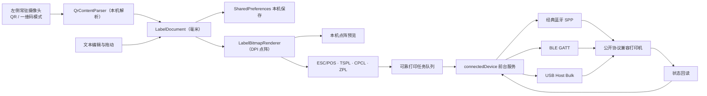

# 原生 Android 架构

## 设计原则

1. 离线优先：应用不申请 `INTERNET` 权限，不依赖远程页面、CDN、账号或云服务。
2. 物理尺寸优先：文档使用毫米保存位置与尺寸，只在预览和打印阶段转换为像素/点阵。
3. 设备能力隔离：扫码、画布、渲染、协议编码、硬件端点和任务队列分成独立模块。
4. 最小权限：仅在用户实际扫码或连接打印机时申请相机、附近设备权限。
5. 横屏工作站优先：平板主界面按左 1/3 扫码解析、右 2/3 打印画布分区，相机不再遮盖打印设置。

## 数据流



## 源码模块

| 路径 | 职责 |
|---|---|
| `MainActivity.java` | 权限、扫码、编辑器、预览、自动发现和硬件服务 UI |
| `res/layout-land/activity_main.xml` | 横屏平板 1:2 主界面；左侧相机/解析，右侧打印机/画布 |
| `view/BarcodeModeSwitch.java` | 轨道内双标签的二维码/条形码模式滑块 |
| `scan/ScanFormatCatalog.java` | 为嵌入式和备用扫描页提供互斥的 QR/一维码格式集合 |
| `scan/QrContentParser.java` | 不联网解析普通文本、URI 参数和常见键值扫码内容 |
| `model/` | 标签文档、文本元素、毫米约束和本机持久化 |
| `view/LabelCanvasView.java` | 按画布比例显示标签、选中和拖动文本 |
| `render/LabelBitmapRenderer.java` | 根据 203/300 DPI 生成打印位图 |
| `protocol/` | 统一 1-bit 点阵与 ESC/POS、TSPL、CPCL、ZPL 编码器 |
| `device/` | 统一端点、设备档案、可信度匹配和本机配置保存 |
| `job/` | 打印任务与可区分的发送/确认/失败/取消状态 |
| `hardware/` | ESC/POS、ZPL 状态探测与统一硬件状态 |
| `print/BluetoothPrinterManager.java` | SPP/BLE 扫描、双向连接、GATT 发现与传输 |
| `print/UsbPrinterManager.java` | USB Host 枚举、逐设备授权、Bulk OUT/IN 与拔插处理 |
| `service/PrinterConnectionService.java` | 统一传输入口、前台生命周期、队列、幂等、取消、重试和自动重连 |

## 离线依赖

构建时使用 AndroidX、ZXing Embedded 和 ZXing Core。它们会进入 APK；安装后的应用扫码和打印不需要联网。开发机首次解析 Gradle 依赖时可能需要从 Maven 仓库下载一次，之后可使用 Gradle 缓存离线构建。

## 当前边界与后续演进

- 通用公开语言只保证数据完整写入传输通道，不伪装成“纸张已经打印完成”；逐任务物理完成回执需要对应厂商协议。
- Android 7–15 使用 `sensorLandscape` 作为横屏默认；API 36 使用临时兼容属性保持现有专用平板模式。Android 17 起大屏系统可忽略方向锁定，因此竖屏资源仍作为安全回退，不作为 v1.3 首要优化对象。
- 增加获得合法授权的厂商 SDK、私有状态回执或 USB Serial 适配器。
- 增加旋转、字体选择、条码/二维码元素和多模板管理。
- 建立真实机型兼容测试矩阵，并保存打印宽度、浓度和走纸配置。

---

## 260818 德佟 WePrint/DzPrinter 私有协议整体整合计划

> 本节是逆向实现工作记录；勾选表示代码路径或离线测试完成，不表示真机认证。真机范围统一以 `PRINTER_COMPATIBILITY.md` 和 `VALIDATION_V1.4.md` 为准。

> 计划标识：`260818`
>
> 适用范围：仅德佟 WePrint/DzPrinter 私有协议层，不涉及云服务、账号、模板商城、OCR 等业务。
> 目标：把当前散落且半成品的 P1 私有协议，重构为一个离线可验证的完整协议模块，并保留无法离线验证或当前不实现的扩展项。

### 一、已确认边界

1. 本应用保持离线，不申请网络权限，不实现任何联网功能。
2. 不实现云端账号、登录和云端 `helloToken/loginToken` 获取；离线授权握手 `0x9E/0x9F` 只作为显式开启的实验能力，默认不发送。
3. RLE 不作为默认启用。默认仍使用 `0x2B` 原始行，`0x29/0x2C/0x2D/0x2E/0x3A/0x3B/0x3C/0x3D` 作为高级可选能力。
4. WiFi、DUAL/LSPP、16/303 机型兼容、NFC 读取为保留项目，不纳入本轮必须交付，但需在本文档细化。
5. 其余离线可验证的协议能力按本计划整合。

### 二、整体范围

#### 本轮必须完成

- 统一二进制帧编解码与流解析。
- ASCII 文本命令模式。
- 完整发送指令目录。
- 完整接收命令解析。
- 离线授权握手 `0x9E/0x9F`，包含 8 组离线令牌，默认关闭。
- 设备名识别与蓝牙通道判定。
- WePrint BLE GATT 服务/特征选择规则。
- 打印状态机整体重构。
- UI 按“常用直接显示、高级折叠”重组。

#### 本轮明确不做

- 云账号、云 token、云模板、耗材同步。
- 在线防伪服务与云端授权密钥管理。
- 网络状态上报。
- RLE 默认启用。

#### 保留项目

- WiFi 打印通道。
- DUAL/LSPP 双模与低功耗 SPP 通道。
- 16mm/303 DPI 机型及 ESC/POS 兼容路径。
- NFC 碰一碰读取与 NDEF 路由。

### 三、目标架构

```text
MainActivity / UI
        │
        ▼
DothanProtocolEngine
   ├─ DothanFrameCodec          帧编解码
   ├─ DothanFrameStreamParser   二进制/文本增量流解析
   ├─ DothanCommandCatalog      发送命令目录与语义
   ├─ DothanReceiveParser       接收命令目录与语义
   ├─ DothanBitmapEncoder       原始行 + RLE 行编码
   ├─ DothanDeviceIdentity      设备名/通道/机型识别
   ├─ DothanManufacturerInfo    0x40 subtype 4 厂商与耗材信息
   └─ DothanStateMachine        连接/参数/打印/回执状态机
        │
        ▼
PrinterConnectionService + BluetoothPrinterManager / UsbPrinterManager
```

### 四、工作分解与结果回写

#### 阶段 0：基线保护与测试夹具

| 编号 | 计划项 | 完成条件 | 状态 | 实际结果/证据 | 回写日期 |
|---|---|---|---|---|---|
| 0.1 | 锁定已验证 P1 默认行为 | 默认档案仍为 `UNCOMPRESSED`，已有 P1 真机打印路径不回归 | [x] 完成 | 结果：`PrinterProfile` 默认 `UNCOMPRESSED`；`testDebugUnitTest` 通过 | 260818 |
| 0.2 | 建立 Dothan 帧/命令测试夹具 | 至少覆盖 `0x1F/AA/BB`、变长长度、CRC、分包/合包 | [x] 完成 | 结果：`DothanFrameCodecTest`、`DothanProtocolEncoderTest` 已覆盖并通过 | 260818 |
| 0.3 | 建立厂商信息块测试样本 | 用反编译源码中的字段规则构造最小合法 `0x40` subtype 4 样本 | [x] 完成 | 结果：`DothanManufacturerInfoTest` 已构造最小合法块并通过 | 260818 |
| 0.4 | 建立行编码回归样本 | 原始行、字节 RLE、位 RLE 和容量回退有固定样本 | [x] 部分完成 | 结果：基础模式和膨胀回退已覆盖；4/6 位及 XOR 仍需固定向量 | 260818 |

#### 阶段 1：协议核心模块整合

| 编号 | 计划项 | 完成条件 | 状态 | 实际结果/证据 | 回写日期 |
|---|---|---|---|---|---|
| 1.1 | 整合 `DothanFrameCodec` | 帧头、长度、CRC、`0x88` 免校验逻辑集中且可测试 | [x] 完成 | 结果：已有实现继续通过测试 | 260818 |
| 1.2 | 整合 `DothanFrameStreamParser` | 支持二进制、ASCII 文本、碎片/合包、超时丢弃 | [x] 完成 | 结果：二进制/文本/合包及 2 秒陈旧碎片丢弃均有测试 | 260818 |
| 1.3 | 新增 `DothanCommandCatalog` | 所有发送命令统一命名、构造、注释和测试 | [x] 完成 | 结果：已新增并让编码器/设置编码器复用 | 260818 |
| 1.4 | 新增 `DothanReceiveParser` | 所有接收命令统一分发、解析、摘要和测试 | [x] 完成 | 结果：已新增并接入服务诊断，测试通过 | 260818 |
| 1.5 | 保留 `DothanBitmapRowEncoder` | RLE 能力集中，默认仍走原始行，不默认启用 | [x] 完成 | 结果：已有实现继续通过测试 | 260818 |
| 1.6 | 收敛 `DothanManufacturerInfo` | `0x40` subtype 4 字段级解析与产品号映射 | [x] 完成（代码级） | 结果：字段解析与产品号映射已补；未取得真机上报 | 260818 |

#### 阶段 2：发送指令补齐

| 编号 | 计划项 | 完成条件 | 状态 | 实际结果/证据 | 回写日期 |
|---|---|---|---|---|---|
| 2.1 | 基础参数命令 | `0x42/0x43/0x44/0x45` 保持兼容 | [x] 完成 | 结果：已收敛到 `DothanCommandCatalog` | 260818 |
| 2.2 | 电机模式 `0x47` | 支持离线档案设置、编码与测试 | [x] 完成（实验性） | 结果：档案、UI、编码器与测试已接通；默认不下发，待真机 | 260818 |
| 2.3 | 自动关机 `0x48` | 现有逻辑收敛到命令目录 | [x] 完成 | 结果：已收敛到 `DothanCommandCatalog` | 260818 |
| 2.4 | 语言 `0x49` | 支持离线档案设置、编码与测试 | [x] 完成（实验性） | 结果：档案、UI、编码器与测试已接通；默认不下发，待真机 | 260818 |
| 2.5 | 速度+日期时间 `0x78` | 按二进制字段编码，日期时间可配置 | [x] 记录跳过 | 结果：二进制编码器有测试；自动写日期时间有副作用，未接服务 | 260818 |
| 2.6 | 会话 `0x80/0x84` | 补齐旧固件 `0x7F` 与新固件 `0x49` 分支 | [x] 完成 | 结果：服务已改用 `sessionStart(true)` 与目录命令 | 260818 |
| 2.7 | 位图命令集 | 覆盖页命令、原始行及多种 RLE 行表示 | [x] 部分完成（实验性） | 结果：编码器路径已接入；默认仍为原始行，高级固定向量和真机待补 | 260818 |
| 2.8 | 打印份数、边距、方向、翻转、反色 | 统一进入打印任务参数，协议层按需编码 | [x] 部分完成（实验性） | 结果：有效位图变换和 UI 已接入；任务级对齐因无独立目标画布宽度未开放 | 260818 |

#### 阶段 2A：离线授权握手

| 编号 | 计划项 | 完成条件 | 状态 | 实际结果/证据 | 回写日期 |
|---|---|---|---|---|---|
| 2A.1 | 默认密钥表 | 内置资料中的 8 组 `helloToken/loginToken`，仅用于离线兜底 | [x] 完成 | 结果：`DothanAuthHandshake` 内置 8 组，`[removed embedded credential]` 已补全 | 260818 |
| 2A.2 | 握手发送 | 按资料规则发送 `0x9E + helloToken`，不依赖网络 | [x] 完成（实验性） | 结果：仅显式启用内置令牌或配置自定义 token 时发送；默认关闭 | 260818 |
| 2A.3 | 握手回执 | 解析 `0x9F` 并比较 `loginToken`，匹配/不匹配/超时分别处理 | [x] 完成 | 结果：`handleDothanAuthReply` 匹配/不匹配/超时路径已接入 | 260818 |
| 2A.4 | 状态与回退 | 握手状态机纳入打印状态机；无 token 时安全跳过 | [x] 完成（实验性） | 结果：默认跳过；用户显式 token 优先于内置令牌 | 260818 |
| 2A.5 | 单元测试 | 密钥复制隔离、匹配/不匹配和帧结构有测试 | [x] 部分完成 | 结果：基础测试通过；超时和真实固件分支待集成/真机 | 260818 |

#### 阶段 3：接收命令补齐

| 编号 | 计划项 | 完成条件 | 状态 | 实际结果/证据 | 回写日期 |
|---|---|---|---|---|---|
| 3.1 | `0x40` 参数/状态综合上报 | 子类型 1=参数、4=厂商信息可解析 | [x] 完成 | 结果：逆向确认 subtype 1=参数、4=厂商信息，已解析 | 260818 |
| 3.2 | `0x4D` 标志 | J/I/H 三个布尔状态完整解析 | [x] 完成 | 结果：`DothanReceiveParser` 已解析 J/I/H | 260818 |
| 3.3 | `0x52/0x57/0x59` 数组 | 多字节数组读取并进入设备参数模型 | [x] 完成 | 结果：已解析为无符号字节数组 | 260818 |
| 3.4 | `0x70` 完成回执 | 页状态、页号、拷贝数全部解析 | [x] 完成 | 结果：状态、页号、拷贝数已解析 | 260818 |
| 3.5 | `0x71/0x72` 完整回读 | DPI、宽度、浓度、档位全部解析 | [x] 完成 | 结果：DPI、宽度、浓度、速度已解析 | 260818 |
| 3.6 | `0x73` 计数器/ID | 四个 32 位字段解析 | [x] 完成 | 结果：四个 32 位字段已解析 | 260818 |
| 3.7 | `0x75` 名称字符串 | GBK 文本解析 | [x] 完成 | 结果：GBK 解析与 JVM 测试已覆盖，异常时回退 ASCII | 260818 |
| 3.8 | `0x77/0x7B` 缓冲区 | 两种缓冲回报均解析 | [x] 完成 | 结果：统一映射为字节数 | 260818 |
| 3.9 | `0x78/0x79` | 单字节状态和设备名解析 | [x] 完成 | 结果：状态与设备名已解析 | 260818 |
| 3.10 | `0x7D` 全参数块 | 保留原始块并解析已确认字段 | [x] 部分完成 | 结果：原始块完整保留；仅确认并解析 7 字节地址记录的通道/MAC | 260818 |

#### 阶段 4：设备识别与 BLE GATT

| 编号 | 计划项 | 完成条件 | 状态 | 实际结果/证据 | 回写日期 |
|---|---|---|---|---|---|
| 4.1 | 设备名解析器 | 支持正则、加权校验位、`/20` 通道判定、`@N` 产品索引 | [x] 完成（未接发现） | 结果：离线解析器已测试，表 `{305,180,203,300,600}` 是 DPI，不是点宽 | 260818 |
| 4.2 | 白名单匹配 | 支持机型名单与防伪串匹配的离线部分 | [x] 记录跳过 | 结果：反编译字符串资源为空，白名单为云端/运行时配置，无法离线复刻 | 260818 |
| 4.3 | BLE GATT 规则 | 按 FF00/FF01/FF02/FF03 规则选择服务/写/通知特征 | [x] 完成（待真机） | 结果：FF02 写、FF01 Notify、FF03 可选 credit；FFE1 兼容路径；Microchip 为已验证基线 | 260818 |
| 4.4 | 180A 信息读取 | 串行读取 2A24 型号、2A28 软件版本并展示 | [x] 完成（待真机） | 结果：严格串行并带可选读取超时，不阻断主连接 | 260818 |

#### 阶段 5：状态机整合

| 编号 | 计划项 | 完成条件 | 状态 | 实际结果/证据 | 回写日期 |
|---|---|---|---|---|---|
| 5.1 | 主状态机建模 | 暴露连接、参数、打印、回执等可观测阶段 | [x] 部分完成 | 结果：当前为阶段跟踪器，不校验非法状态迁移 | 260818 |
| 5.2 | 参数读写状态机 | 读取阶段与写入确认阶段可复用 | [x] 完成 | 结果：新增 `SETTINGS_WRITE/SETTINGS_VERIFY`，并接入 `applyPendingP1Settings` | 260818 |
| 5.3 | 打印流控状态机 | `0x77` 缓冲、分块发送、`0x70` 回执、取消/失败恢复 | [x] 完成（基线） | 结果：服务路径已接入，0x70 轮询在指定 P1 真机验证；新增授权/RLE 分支未验证 | 260818 |
| 5.4 | 错误码映射 | 私有回执错误码提供可读说明 | [x] 部分完成 | 结果：`receiptStatus` 覆盖 12、20、30–46、50；尚无独立类型模型和固定测试 | 260818 |

#### 阶段 6：UI 整合与文档

| 编号 | 计划项 | 完成条件 | 状态 | 实际结果/证据 | 回写日期 |
|---|---|---|---|---|---|
| 6.1 | 常用/高级分组 | 常用项直接显示，高级项折叠；RLE 默认关闭 | [x] 完成 | 结果：`showProfileSettings` 已按常用/高级折叠，默认未压缩 | 260818 |
| 6.2 | 协议诊断面板 | 厂商信息、设备参数、GATT、状态机轨迹可读 | [x] 完成 | 结果：诊断已含厂商信息、设备模型、GATT 型号/固件、状态机 | 260818 |
| 6.3 | 文档同步 | ARCHITECTURE、PROTOCOLS、README 反映真实完成度 | [x] 完成 | 结果：ARCHITECTURE、PROTOCOLS、README 均已同步 | 260818 |
| 6.4 | 测试与构建 | JVM 单测、Lint、`assembleDebug` 通过 | [x] 完成 | 结果：强制重跑 70 项测试全通过；Lint 0 error；Debug APK 构建通过 | 260818 |

### 五、保留项目细化

#### R1 WiFi 打印通道

- 目标：增加 WiFi/TCP 打印通道，与现有 SPP/BLE/USB 并列。
- 前置条件：获得目标打印机的 WiFi 网络协议说明、端口与认证方式；确定是否使用 Raw TCP 9100、LPD 或厂商私有端口。
- 详细工作内容：
  1. 在 `TransportType` 增加 `WIFI_TCP`。
  2. 增加 `WifiPrinterManager`，支持 IP/端口配置、连接超时、TCP 读写、断线重连。
  3. `PrinterConnectionService` 统一接入 Wifi 端点、前台服务和任务队列。
  4. 设备发现策略：局域网扫描属于联网能力，需重新评估离线原则，不能默认开启。
  5. 兼容性矩阵增加 WiFi 行，并在未实机验证前保持“未认证”。
- 验收标准：能连接指定 IP 打印机并发送/回读，断线后按现有退避策略重连，无实机前不得标记兼容。
- 风险：网络权限与离线承诺冲突，需单独评审。
- 结果回写：`结果：待填写` / `回写日期：待填写`

#### R2 DUAL/LSPP 双模与低功耗 SPP

- 目标：按设备名解析结果在 SPP、BLE、DUAL、LSPP 之间选择正确通道。
- 前置条件：具备 DUAL/LSPP 真机或明确固件文档。
- 详细工作内容：
  1. 扩展 `TransportType` 或新增通道能力字段，区分 `CLASSIC_SPP`、`BLE_GATT`、`DUAL`、`LSPP`。
  2. 设备名 `第2-3位数字/20` 通道判定接入 `DeviceCatalog`。
  3. `BluetoothPrinterManager` 增加 LSPP/DUAL 连接策略与回退顺序。
  4. 自动发现评分纳入通道类型，避免把 DUAL 设备当成普通 BLE 处理。
  5. 兼容性矩阵增加 DUAL/LSPP 测试行。
- 验收标准：能根据真实设备名和连接结果自动选择正确通道；错误回退不产生重复打印。
- 风险：LSPP 依赖 Android 厂商兼容性和真机行为，纯代码无法闭环。
- 结果回写：`结果：待填写` / `回写日期：待填写`

#### R3 16mm/303 DPI 机型兼容

- 目标：支持资料中宽度 16、303 机型的 ESC/POS 兼容指令路径。
- 前置条件：获得对应机型或明确指令表，确认协议分支条件。
- 详细工作内容：
  1. 在 `DothanCommandCatalog` 增加 303 机型命令：`ESC J`、`ESC @`、`GS v 0`、`GS V B 0`、`SUB 7/8/9/:`、`FF`。
  2. 在设备档案中增加宽度档位和协议分支标记。
  3. `DothanProtocolEncoder` 按机型选择 Dothan 位图路径或 ESC/POS 光栅路径。
  4. 增加 16/303 机型的默认 DPI、点宽、纸张与间隙参数。
  5. 兼容性矩阵增加 16/303 机型行。
- 验收标准：在没有真实打印机前，编码输出可通过单元测试验证结构，但不得标记真机兼容。
- 风险：研究文档中部分 16/303 分支仍有待黑盒验证，需避免误发命令。
- 结果回写：`结果：待填写` / `回写日期：待填写`

#### R4 NFC 碰一碰读取

- 目标：读取德佟 NFC 标签并解析设备信息，必要时触发连接。
- 前置条件：NFC 真机标签、NDEF 路由规则和 Android NFC 权限评审。
- 详细工作内容：
  1. 完成 `DothanNfcInfo` 解析器的样本测试，固定 `0xAA/0xBB` 载荷结构。
  2. 在 Manifest 增加 `NFC` 权限和 `uses-feature android:name="android.hardware.nfc" android:required="false"`。
  3. 增加 NDEF 前台分发或 `NfcManagerActivity` 路由，解析设备类型、MAC、DPI、宽度。
  4. 将解析结果转成 `DeviceCandidate`，进入现有设备详情确认流程。
  5. 明确不清除用户已选设备，不自动连接，除非用户确认。
- 验收标准：NFC 标签能解析出正确设备信息，并显示在设备详情页；无标签时不影响主流程。
- 风险：NFC 路由需要 `NDEF_DISCOVERED` 实际标签验证，且可能引入外部 Intent 攻击面，需安全评审。
- 结果回写：`结果：待填写` / `回写日期：待填写`

### 六、结果回写总表

| 阶段 | 范围 | 当前状态 | 回写结果 | 回写日期 |
|---|---|---|---|---|
| 0 | 基线保护与测试夹具 | [x] 完成 | 基线测试通过，默认原始行 | 260818 |
| 1 | 协议核心模块整合 | [x] 完成 | 命令目录、文本模式、接收解析器、厂商信息完成 | 260818 |
| 2 | 发送指令补齐 | [x] 完成（记录跳过 2.5） | 核心指令、任务选项与份数边距完成；日期同步记录跳过 | 260818 |
| 2A | 离线授权握手 | [x] 部分完成（实验性） | 默认关闭；帧/匹配测试完成，真实固件与超时分支待验证 | 260818 |
| 3 | 接收命令补齐 | [x] 完成（代码级） | 主要接收命令、GBK 与 0x40/0x7D 已解析 | 260818 |
| 4 | 设备识别与 BLE GATT | [x] 部分完成 | GATT/180A/设备名离线规则已实现；名称规则未接发现，兼容服务待真机 | 260818 |
| 5 | 状态机整合 | [x] 完成 | 精简离线状态集与参数读写会话已接入 | 260818 |
| 6 | UI 整合与文档 | [x] 完成 | 折叠 UI、诊断、文档同步与构建完成 | 260818 |
| R1 | WiFi 打印通道 | [ ] 保留 | 待填写 | 待填写 |
| R2 | DUAL/LSPP | [ ] 保留 | 待填写 | 待填写 |
| R3 | 16mm/303 DPI | [ ] 保留 | 303 命令序列已逆向；默认参数与实机未验证 | 260818 |
| R4 | NFC 碰一碰读取 | [ ] 保留 | 载荷与连接链已逆向；Android 硬件未接 | 260818 |

### 七、回写规则

1. 每完成一项，把对应阶段表状态改为 `[x] 完成` 或 `[x] 部分完成`。
2. `实际结果/证据` 填写测试命令、APK 路径、真机记录或未完成原因。
3. `回写日期` 使用 `YYMMDD` 格式，保持与计划标识一致。
4. 保留项目只有在完成并验证后才能把状态改为 `完成`；未验证时只能写 `保留` 或 `部分完成`。
5. 本文档是唯一结果回写入口，不再在对话里散落状态。
