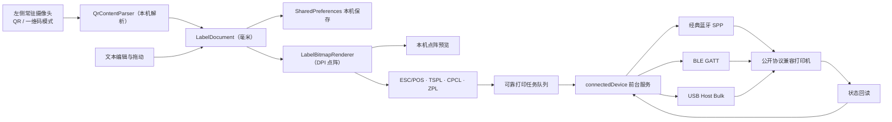

# 原生 Android 架构

## 设计原则

1. 离线优先：应用不申请 `INTERNET` 权限，不依赖远程页面、CDN、账号或云服务。
2. 物理尺寸优先：文档使用毫米保存位置与尺寸，只在预览和打印阶段转换为像素/点阵。
3. 设备能力隔离：扫码、画布、渲染、协议编码、硬件端点和任务队列分成独立模块。
4. 最小权限：仅在用户实际扫码或连接打印机时申请相机、附近设备权限。
5. 横屏工作站优先：平板主界面按左 1/3 扫码解析、右 2/3 打印画布分区，相机不再遮盖打印设置。

## 数据流

## 源码模块

| 路径 | 职责 |
|---|---|
| `MainActivity.java` | 权限、扫码、编辑器、预览、自动发现和硬件服务 UI |
| `res/layout-land/activity_main.xml` | 横屏平板 1:2 主界面；左侧相机/解析，右侧打印机/画布 |
| `view/BarcodeModeSwitch.java` | 轨道内双标签的二维码/条形码模式滑块 |
| `scan/ScanFormatCatalog.java` | 为嵌入式和备用扫描页提供互斥的 QR/一维码格式集合 |
| `scan/QrContentParser.java` | 不联网解析普通文本、URI 参数和常见键值扫码内容 |
| `model/` | 标签文档、文本元素、毫米约束和本机持久化 |
| `view/LabelCanvasView.java` | 按画布比例显示标签、选中和拖动文本 |
| `render/LabelBitmapRenderer.java` | 根据 203/300 DPI 生成打印位图 |
| `protocol/` | 统一 1-bit 点阵与 ESC/POS、TSPL、CPCL、ZPL 编码器 |
| `device/` | 统一端点、设备档案、可信度匹配和本机配置保存 |
| `job/` | 打印任务与可区分的发送/确认/失败/取消状态 |
| `hardware/` | ESC/POS、ZPL 状态探测与统一硬件状态 |
| `print/BluetoothPrinterManager.java` | SPP/BLE 扫描、双向连接、GATT 发现与传输 |
| `print/UsbPrinterManager.java` | USB Host 枚举、逐设备授权、Bulk OUT/IN 与拔插处理 |
| `service/PrinterConnectionService.java` | 统一传输入口、前台生命周期、队列、幂等、取消、重试和自动重连 |

## 离线依赖

构建时使用 AndroidX、ZXing Embedded 和 ZXing Core。它们会进入 APK；安装后的应用扫码和打印不需要联网。开发机首次解析 Gradle 依赖时可能需要从 Maven 仓库下载一次，之后可使用 Gradle 缓存离线构建。

## 当前边界与后续演进

- 通用公开语言只保证数据完整写入传输通道，不伪装成“纸张已经打印完成”；逐任务物理完成回执需要对应厂商协议。
- Android 7–15 使用 `sensorLandscape` 作为横屏默认；API 36 使用临时兼容属性保持现有专用平板模式。Android 17 起大屏系统可忽略方向锁定，因此竖屏资源仍作为安全回退，不作为 v1.3 首要优化对象。
- 增加获得合法授权的厂商 SDK、私有状态回执或 USB Serial 适配器。
- 增加旋转、字体选择、条码/二维码元素和多模板管理。
- 建立真实机型兼容测试矩阵，并保存打印宽度、浓度和走纸配置。
