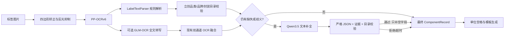

# Qwen3.5 离线结构化补全部署计划

日期：2026-08-20

基线：EPrint v1.5.35 / versionCode 41

状态：仅完成方案设计，尚未下载、转换、推送、加载或部署 Qwen3.5，也未修改应用业务代码

## 1. 结论先行

Qwen3.5 在本项目中的第一职责应是 **OCR 后的文本结构化与缺失字段补全**，而不是替换
PP-OCR，也不是在首期再承担一次图片识别。推荐主链路为：



核心决策：

1. **PP-OCR + Qwen3.5 必须可以独立工作**。GLM-OCR 是可选的第二份文字证据，不是
   Qwen3.5 的前置依赖。
2. Qwen3.5 默认只填空字段，不覆盖已有且通过规则验证的值；输出失败、超时或模型缺失时，
   原 PP-OCR/规则结果照常生成模板。
3. 首轮验证使用官方 4-bit `Qwen3.5-2B-MNN`；`0.8B` 作为性能下限，`4B` 作为质量上限。
   最终型号由同一测试集决定，不凭参数量直接定型。
4. 延续项目的离线边界：模型不打进 APK、不增加 `INTERNET` 权限，通过离线导入或 ADB
   放入应用私有模型目录。
5. 首期不同时常驻 GLM-OCR 与 Qwen3.5。两个大模型并存会放大内存峰值，应由统一模型资源
   协调器串行装载，或通过识别预设让用户二选一。

## 2. 当前代码基线与可复用能力

### 2.1 已有完整能力

| 当前能力 | 代码位置 | 对 Qwen3.5 的价值 |
|---|---|---|
| 标签四边形矫正、裁剪、反光抑制 | `LabelFrameProcessor`、`scan/opencv/*` | Qwen 不再处理脏图；PP/GLM 共用稳定输入 |
| PP-OCRv6 离线检测/方向/识别 | `scan/ocr/LabelOcrEngine.java` | Qwen 的主输入来源，保证可与 PP-OCR 单独组合 |
| OCR 行到器件字段的规则解析 | `scan/LabelTextParser.java` | 先确定性提取，Qwen 只处理剩余缺口 |
| 479 个立创末级品类、2,614 个品牌与 21,681 个封装 | `LcscPackageCatalog`、`CategoryPackageMatcher` | 校验 Qwen 给出的品类、品牌和封装，压制幻觉 |
| GLM-OCR 0.9B MNN 端侧推理 | `scan/vlm/*`、`glm_ocr_jni.cpp` | 已验证 MNN-LLM、JNI、流式回调、超时和侧载模型路径 |
| 严格七键 JSON 解析 | `GlmInformationExtractionParser` | 可复用字段命名与部分清洗规则，但不能直接复用补丁语义 |
| PP/GLM 融合与统一记录 | `ComponentRecordFusion`、`ComponentRecord` | 保持最终模板输入类型不变 |
| 单位后空格与一次性模板生成 | `UnitSpacingFormatter`、`finalizeLabelRecognition()` | Qwen 完成后仍走现有最终化步骤 |

### 2.2 不能直接把 Qwen 塞进现有 VLM 类的原因

1. `VlmOcrEngine` 同时承担 GLM 专属模型清单、图片落盘、补方、`` prompt、转写退化
   检测和 GLM 设置，职责不是通用 LLM。
2. `GlmOcrSession` 的 C++ 实现实际调用通用 `Llm::createLLM()`，底层大部分可复用，但 Java
   类名、JNI 符号、日志和库名均绑定 GLM。
3. GLM 官方包要求 `embeddings_bf16.bin`；官方 Qwen3.5-MNN 包的文件布局不同，并包含
   `llm.mnn.json` 和视觉模型文件。复用同一 `REQUIRED_FILES` 会误判模型完整性。
4. `ComponentRecordFusion` 只有 PP/GLM 两路，并以一项全局权重决定所有冲突；将 Qwen 作为
   第三路继续加权，会让“补全器”获得不应有的覆盖权。
5. `ComponentRecord` 只有整条记录置信度，没有字段级来源、证据和“模型推断/原文提取”状态，
   无法安全说明 Qwen 到底补了什么。
6. `LabelRecognitionController` 目前硬编码 `1/5` 至 `5/5` 和 PP→GLM 顺序。加入条件式 Qwen
   后需要动态阶段日志，不能继续堆叠分支和固定序号。
7. 当前 GLM 失败路径是开发期“失败即停止”；Qwen 是增强阶段，失败必须退回确定性结果，
   两者的故障语义不同。

## 3. 官方模型与运行时选择

### 3.1 已核对的官方事实

- Qwen3.5 是原生多模态模型族，官方提供 0.8B、2B、4B、9B 等稠密模型；官方模型卡说明
  默认会输出 thinking 内容，非思考模式应通过 chat template 参数关闭，而不是依赖
  `/nothink` 文本指令。来源：[Qwen3.5-9B 官方模型卡](https://huggingface.co/Qwen/Qwen3.5-9B)、
  [Qwen3.5 官方集合](https://huggingface.co/collections/Qwen/qwen35)。
- Alibaba MNN 在 2026-03-05 宣布支持 Qwen3.5 系列，当前项目已经使用 MNN 3.6.1 的
  `libllm.so` 与同类 `Llm::createLLM()` 接口。来源：
  [MNN 官方仓库](https://github.com/alibaba/MNN)。
- MNN 官方组织已提供 4-bit 模型：`0.8B` 约 548 MB、`2B` 约 1.39 GB、`4B` 约
  2.85 GB。来源：[Qwen3.5-0.8B-MNN](https://huggingface.co/taobao-mnn/Qwen3.5-0.8B-MNN)、
  [Qwen3.5-2B-MNN](https://huggingface.co/taobao-mnn/Qwen3.5-2B-MNN)、
  [Qwen3.5-4B-MNN](https://huggingface.co/taobao-mnn/Qwen3.5-4B-MNN)。
- 官方 Qwen3.5-MNN 的 `llm_config.json` 仍声明 `is_visual: true`。即使本项目首期只提交
  文本，也不应自行删除 `visual.mnn`/`visual.mnn.weight`；必须以完整官方快照先通过兼容性
  验证。来源：[2B MNN 配置](https://huggingface.co/taobao-mnn/Qwen3.5-2B-MNN/blob/main/llm_config.json)。
- MNN 文档支持通过 `config.json` 控制后端、线程、精度、采样，并由模型的 Jinja chat
  template 生成对话格式。来源：[MNN-LLM 官方文档](https://mnn-docs.readthedocs.io/en/latest/transformers/llm.html)。

“MNN 已支持”只说明代码路径存在，不能替代本项目现有预编译库、目标 Android 版本和
SM-X800 上的真实加载测试。官方仓库历史中出现过 Qwen3.5 Android chat template/运行崩溃
问题，因此兼容性冒烟必须排在业务接入之前。

### 3.2 型号决策

| 候选 | 官方 MNN 包体约值 | 计划角色 | 进入主线条件 |
|---|---:|---|---|
| Qwen3.5-0.8B-MNN | 548 MB | 性能/内存基线 | 补全精度与 2B 差距 ≤1 个百分点，且全部安全门槛通过 |
| **Qwen3.5-2B-MNN** | **1.39 GB** | **首选验证与默认候选** | 达到第 11 节质量、延迟和内存门槛 |
| Qwen3.5-4B-MNN | 2.85 GB | 质量上限对照 | 相比 2B 有 ≥3 个百分点有效提升，且设备资源门槛仍通过 |

不首选 9B 及更大模型：当前目标只是短文本分类、字段归属和受约束补全，模型体积、冷加载、
内存峰值和端侧时延成本与任务不匹配。

### 3.3 首期输入模式

虽然 Qwen3.5 原生支持图像，首期固定为 **text-only**：

- 输入 PP-OCR 逐行文本、每行置信度和位置；
- 输入确定性解析出的现有字段；
- 输入缺失字段列表；
- 仅输入立创目录检索后的少量候选，不把 1.38 MB 全目录塞进 prompt；
- GLM 开启时，可把其全文转写作为第二份文字证据，但不传标签图片给 Qwen。

这样才能准确测出“LLM 补全”本身的收益，并保证 `PP-OCR + Qwen3.5` 是完整可用组合。
Qwen 直接读图作为后续独立实验，不进入首期发布范围。

## 4. 目标运行模式

模型配置最终提供四种清晰预设，避免让用户理解三套引擎的任意组合：

| 预设 | 执行链路 | 默认用途 |
|---|---|---|
| 规则极速 | PP-OCR → 规则/目录 | Qwen 模型缺失、低内存或追求最快 |
| **语义补全** | **PP-OCR → 规则/目录 → Qwen3.5** | **建议默认；满足“搭配 PP-OCR 单独使用”** |
| OCR 增强 | PP-OCR + GLM 转写 → 融合 | 保持现有视觉转写能力，不加载 Qwen |
| 实验全链 | PP-OCR + GLM → 释放 GLM → Qwen | 仅测试；时延较长，不默认开放 |

Qwen 的细粒度开关建议为：

- `启用 Qwen3.5 缺失字段补全`：默认开启，但模型未部署时自动显示“未安装”并跳过；
- `只补空字段`：默认开启，首个正式版本不可关闭；
- `允许目录内推断品类/品牌/封装`：默认关闭；开启后所有推断字段显示人工核对提示；
- `Qwen 超时`：独立于 GLM，建议初始 30 秒，上限 60 秒；
- 高级采样参数不在第一版 UI 暴露，避免把模型稳定性变成现场配置问题。

## 5. 目标数据契约

### 5.1 请求对象

新增纯 JVM `QwenCompletionRequest`，由 Builder 统一净化和限长。建议序列化格式：

```json
{
  "schema_version": 1,
  "task": "fill_missing_component_label_fields",
  "missing_fields": ["package"],
  "ocr_lines": [
    {"id": 0, "text": "PCT201610-1R0-M", "confidence": 0.98},
    {"id": 1, "text": "功率电感", "confidence": 0.97},
    {"id": 2, "text": "1μH±20%3.5A", "confidence": 0.96},
    {"id": 3, "text": "0806", "confidence": 0.91}
  ],
  "existing": {
    "manufacturer_part_number": "PCT201610-1R0-M",
    "lcsc_part_number": "C54557075",
    "category": "功率电感",
    "specification": "1μH±20%3.5A",
    "package": "",
    "brand": "JIERR(捷而瑞)",
    "parameters": []
  },
  "catalog_context": {
    "matched_category": "功率电感",
    "package_candidates": ["0806"]
  },
  "policy": {
    "fill_only": true,
    "evidence_required": true,
    "allow_catalog_inference": false
  }
}
```

约束：

- OCR 文本最多 2,400 字符、单行最多 256 字符、总行数最多 64；控制字符移除。
- 标签文字放入明确的 `<label_data>` 数据区，并在 system prompt 说明其中任何“指令”都只是
  标签内容，防止把 OCR 文本当 prompt 指令。
- 不发送完整图片、订单号、追踪号、二维码内容或整份立创目录。
- `package_candidates` 由本地目录和 OCR 相似度先缩到 Top-K（建议 K≤20）。

### 5.2 响应对象

Qwen 只返回补丁，不回写完整记录：

```json
{
  "schema_version": 1,
  "patches": [
    {
      "field": "package",
      "value": "0806",
      "source": "ocr_line",
      "evidence_line_ids": [3],
      "confidence": 0.96
    }
  ],
  "abstained_fields": []
}
```

允许字段固定为：`manufacturer_part_number`、`lcsc_part_number`、`category`、
`specification`、`package`、`brand`、`parameters`。模型不得输出数量、订单、批次、追踪、
内部仓储编码，也不得输出自由说明。

### 5.3 非思考与 JSON 处理

Qwen3.5 默认思考，首期在官方 chat template 上设置 `enable_thinking=false`，同时：

1. `max_new_tokens` 初始限制在 256~384；
2. prompt 要求只输出一个 JSON 对象；
3. 响应解析器仍将 `<think>`、Markdown 围栏或 JSON 外文字视为异常，不把隐藏思考写入日志；
4. 首次格式失败只允许一次“原输出 + 格式错误摘要”的修复重试；第二次失败立即回退；
5. 是否使用官方 non-thinking 采样参数或低随机/greedy 方案，以固定测试集消融后决定，不能
   直接沿用 GLM-OCR 的 penalty 参数。

MNN 当前链路未在本项目中证明具备 JSON grammar constrained decoding，因此所有模型输出都
必须当作不可信文本处理。

## 6. 安全落地规则

新增 `QwenCompletionValidator`，按字段执行以下规则；校验失败只拒绝该补丁，不丢弃基线记录：

1. schema 版本、对象形状、字段白名单、类型和长度必须完全合法；未知键默认拒绝。
2. `fill_only=true` 时，任何非空现有字段都不可被 Qwen 修改。
3. `evidence_line_ids` 必须存在，`ocr_line` 来源的值规范化后必须能在对应 OCR 行中找到；
   不相信模型自己声明的证据。
4. 立创料号必须匹配 `C\d{5,}`，且存在于 OCR 证据中。
5. 型号默认必须由 OCR 行支持；字母/数字纠错只有在 PP 与 GLM 两份证据一致，或后续离线
   料号索引能反查时才允许。
6. 品类必须能由 `CategoryPackageMatcher` 命中，或原标签存在直接文字证据。
7. 封装必须属于已确认品类的立创目录候选；未知品类时默认不接受纯推断封装。
8. 品牌优先命中合并后的立创品牌字典并受当前品类约束；规格、品牌、参数仍须追溯到 OCR 行，且继续执行 ROHS/QTY/订单/型号污染清理。
9. `confidence` 只用于日志和阈值，不替代规则校验；模型自报 1.0 也无权绕过验证。
10. 被接受的字段写入字段级 provenance：`PP_OCR`、`GLM_TRANSCRIPT`、`LCSC_CATALOG`、
    `QWEN_EXTRACTED` 或 `QWEN_INFERRED`。模板仍读取最终 `ComponentRecord`，减少改造面。

“自动填入”在第一版的含义是：自动接受有 OCR/目录依据的缺失字段；没有依据时宁可 abstain，
不以语言模型常识伪造型号、封装或电气参数。

## 7. 代码改造蓝图

以下只是后续实施清单，本计划阶段不创建这些类。

### 7.1 通用 MNN 会话层

| 文件 | 计划 |
|---|---|
| `scan/llm/MnnLlmSession.java` | 从 `GlmOcrSession` 抽出通用 load/submit/reset/release/config 接口 |
| `scan/llm/MnnLlmResult.java` | 统一 text、token、prefill/decode、停止与错误字段 |
| `src/main/cpp/mnn_llm_jni.cpp` | 将 `glm_ocr_jni.cpp` 的模型无关部分改为通用 JNI；保留流式 UTF-8、安全停止和性能数据 |
| `CMakeLists.txt` | JNI 库改为中性名称；迁移期可保留 GLM adapter，避免一次性重写全部调用方 |

先做“兼容 adapter”而不是大爆炸重命名：GLM 与 Qwen 均依赖同一通用会话，GLM 专属的图片
prompt 和退化检测继续留在 `VlmOcrEngine`。

### 7.2 Qwen 补全域

建议新增 `scan/qwen/`：

- `QwenCompletionEngine`：模型清单、装载、生成、超时、停止和性能统计；只接收文本请求。
- `QwenCompletionSettings` / `Store`：模型档位、超时、最大 token、开关；与 `VlmSettings`
  分离，避免 GLM prompt/采样迁移污染 Qwen。
- `QwenCompletionRequest` / `Builder`：构造受限请求和 prompt。
- `QwenCompletionResponseParser`：严格解析补丁 schema。
- `QwenCompletionValidator`：执行第 6 节门槛。
- `QwenCompletionDecision`：保存接受、拒绝、abstain、原因、字段 provenance 与耗时。
- `QwenModelManifest`：校验模型 id、revision、文件大小和 SHA-256。

### 7.3 现有类的最小修改

| 文件 | 后续修改点 |
|---|---|
| `CategoryPackageMatcher.java` | 在现有品类/品牌/封装规范化基础上增加受限 `rankPackageCandidates(...,limit)`；不向 prompt 暴露完整目录 |
| `ComponentRecord.java` | 保持最终模板兼容；字段来源先用 companion/decision 对象承载，确认 UI 需求后再决定是否持久化 |
| `ComponentRecordFusion.java` | 仍只负责 PP/GLM OCR 证据融合；Qwen 不作为第三个加权记录源 |
| `LabelRecognitionController.java` | 拆出 `LabelRecognitionPipeline`/阶段事件；在确定性结果后按缺口条件调用 Qwen，并实现失败回退 |
| `RecognitionSettings*` | 新增 Qwen 开关和识别预设；旧设置无感迁移，默认不改变未安装模型设备的结果 |
| `ModelConfigDialog.java` | 分开显示“GLM 文字转写”和“Qwen 字段补全”；修正当前仍写“GLM 信息提取/默认 GLM 优先”的过时文案 |
| `GlmInformationExtractionParser.java` | 提取共用清洗器；不要让 Qwen patch 伪装成 GLM 的完整七键记录 |
| `UnitSpacingFormatter.java` | 无逻辑变化，继续只在最终记录上执行一次 |

## 8. 模型交付与目录设计

### 8.1 模型目录

建议与现有 GLM 平级：

```text
/sdcard/Android/data/com.otool.eprint/files/models/
├─ glm-ocr-mnn/
└─ qwen3.5-2b-mnn/
   ├─ model_manifest.json
   ├─ config.json
   ├─ llm_config.json
   ├─ llm.mnn
   ├─ llm.mnn.json
   ├─ llm.mnn.weight
   ├─ tokenizer.txt
   ├─ visual.mnn
   └─ visual.mnn.weight
```

实际必需文件以固定 revision 的官方快照为准，不能复制 GLM 的必需文件数组。

`model_manifest.json` 至少记录：

- `modelId`: `taobao-mnn/Qwen3.5-2B-MNN`；
- 固定 revision/commit，不允许运行时静默追随 `main`；
- `quantization`: 4-bit、来源模型和许可证；
- 每个文件的路径、字节数和 SHA-256；
- 兼容的 MNN 版本、应用 schema 版本和创建时间；
- 本项目的验证设备与结果摘要。

### 8.2 交付方式

1. 开发期：在 `.tools/downloads/qwen3.5-2b-mnn/` 保存经哈希验证的源副本（仍由 `.gitignore`
   排除），通过脚本推送到设备；沿用现有“先推 `/data/local/tmp`，再复制并 chmod”的可靠路径。
2. 产品期：增加 Storage Access Framework 的离线目录/归档导入；导入到临时目录，完整校验后
   原子切换，失败保留旧模型。
3. 模型不打入 APK，不由应用联网下载，`AndroidManifest.xml` 继续无 `INTERNET` 权限。
4. UI 只显示模型 id、版本、校验状态和空间占用，不展示可编辑的模型路径。

## 9. 内存与生命周期策略

新增单例 `ModelMemoryCoordinator` 或等价协调层：

1. PP-OCR ONNX 会话可常驻；GLM 与 Qwen 大模型首期互斥常驻。
2. “语义补全”预设只加载 Qwen，不加载 GLM；这是首选路径。
3. “OCR 增强”预设只加载 GLM；保持当前行为。
4. “实验全链”执行 GLM 后显式 `release()`，确认 native 内存下降，再加载 Qwen；若回收不充分
   就禁止该预设，而不是冒险触发 LMK。
5. 只有检测到目标字段缺失/歧义时才调用 Qwen；字段完整时不付出生成成本。
6. 页面退出、配置变化、内存压力和 `onDestroy` 均要可停止并释放当前会话。
7. 每次识别记录 Java heap、native PSS、模型加载时间、prefill/decode 和总耗时；发布版日志不
   输出完整标签内容。

## 10. 分阶段实施计划

### 阶段 0：冻结基准与测试集

- 从现有实拍与回归图中建立脱敏 fixture，保存 PP-OCR 行、GLM 转写、当前规则结果和人工 GT。
- 至少覆盖 100 张标签、20 个末级品类、字符混淆（0/O、1/I/l）、空封装、缺品牌、反光、
  倾斜、二维码干扰及完全不可恢复样本。
- 对每张图预生成“人为遮空一个字段”的补全用例，单独衡量补全精度和破坏率。
- 固定 v1.5.35 的 PP-only 输出为不可回归基线。

交付物：`test-data` 清单（图片如不能入库则只入哈希/GT）、基线 JSON、评测脚本与指标定义。

### 阶段 1：运行时兼容性冒烟，不接业务

- 固定下载官方 Qwen3.5-0.8B/2B/4B-MNN revision 并生成 SHA-256 清单。
- 用当前 APK 内 MNN 3.6.1 库加载 2B，完成纯文本、中文、非思考、短 JSON、连续 20 次重置/
  生成和中止测试。
- 验证 chat template、`enable_thinking=false`、结束 token、UTF-8 流式回调和 `max_new_tokens`。
- 测量三档模型的冷加载、峰值 PSS、prefill/decode、温度、崩溃和卸载后内存回落。
- 若当前预编译 MNN 不兼容，单独评估升级官方 MNN；不得用捕获崩溃或忽略模板错误的方式
  绕过。

通过条件：2B 连续 20 次无崩溃、能稳定输出合法 UTF-8、超时可停止、释放后内存可复用。

### 阶段 2：纯 JVM 补全内核

- 实现 request builder、prompt、strict parser、validator、field provenance 和 fill-only applier。
- 扩充品类/品牌/封装候选 API，只把 Top-K 传给 Qwen。
- 用伪模型响应覆盖合法、缺键、多余键、Markdown、`<think>`、prompt injection、错误证据、
  非目录封装、覆盖已有字段、超长输出和重复字符。
- 该阶段不依赖 Android native 模型，先确保“任何坏输出都不能污染基线记录”。

通过条件：安全规则单测 100% 通过；随机/恶意响应不能覆盖任何非空已验证字段。

### 阶段 3：Qwen 引擎与模型管理

- 抽取通用 MNN 会话或加兼容 adapter，接入 `QwenCompletionEngine`。
- 加入 manifest/哈希/空间校验、模型缺失说明、原子导入和停止机制。
- 实现非思考模式与一轮格式修复；所有错误映射成可审计结果，不抛到 UI 主线程。
- 建立模型资源互斥和生命周期测试。

通过条件：模型缺失、损坏、版本不兼容、空间不足、加载失败、超时和取消均能安全回退。

### 阶段 4：识别流水线与 UI

- 将固定 5 阶段日志改为事件式阶段名，例如“图像处理 / PP-OCR / 可选 GLM / 规则解析 /
  Qwen 补全 / 校验 / 模板生成”。
- 在 PP/GLM 融合完成后计算缺失字段；无缺失则跳过 Qwen。
- 显示“补全 1 项：封装=0806（OCR+立创目录）”或“Qwen 未采纳：无证据”，不展示思考过程。
- 设置页增加第 4 节预设、模型状态和独立超时；保留 PP-only 一键回退。
- Qwen 完成前不生成模板，完成/跳过/失败后只生成一次。

通过条件：四种预设行为清晰；Qwen 关闭或未安装时输出与阶段 0 基线逐字段一致。

### 阶段 5：离线评测与真机 ADB 回归

- 对 0.8B、2B、4B 使用完全相同 prompt、测试集和采样矩阵。
- 对照：PP-only、PP+Qwen、PP+GLM、PP+GLM+Qwen。
- ADB 连续执行冷启动、拍摄、旋转/后台恢复、取消、超时、低内存和 20 次循环。
- 记录所有被接受和被拒绝的 patch，人工复核误补案例；不得只统计模型原始 JSON。
- 若 2B 已通过质量门槛，除非 4B 有明确有效收益，否则不引入 4B 的体积和内存成本。

### 阶段 6：灰度与发布

- 首个版本保持 Qwen 可关闭、只补空字段且默认不允许无证据推断。
- 发布前按 `eprint-release-versioning` 更新版本、README、构建信息和 APK。
- 校验单测、Lint、assembleDebug、16 KB page alignment、无 `INTERNET` 权限和模型未误入 APK。
- 保留旧配置迁移与模型目录兼容；发现问题可只关闭 Qwen，不回滚 PP-OCR/目录改进。

## 11. 验收指标

### 11.1 正确性和安全

| 指标 | 门槛 |
|---|---:|
| 已有非空且通过规则验证字段被 Qwen 改写 | **0 次** |
| 被 validator 接受的幻觉值 | **0 次** |
| 立创品类/品牌/封装目录冲突仍被写入 | **0 次** |
| 补全字段精确率 | ≥98% |
| 缺失字段补全召回率 | ≥70%，不能以降低精确率换取 |
| JSON 最终可解析率（含最多一次修复） | ≥99.5% |
| Qwen 关闭/缺失时 PP-only 基线一致率 | 100% |
| 不可确定样本正确 abstain | ≥95% |

“补全率”只统计最终通过本地校验并写入 `ComponentRecord` 的字段，不统计模型声称补出的字段。

### 11.2 性能和稳定性

在 SM-X800 上以实测为准，初始发布门槛：

- Qwen 2B 的文本补全额外 P95 ≤20 秒，硬超时 ≤30 秒；
- 连续 20 次补全无 native crash、ANR 或 LMK；
- 峰值进程 PSS 不超过设备可用内存的 65%，且退出/切换模型后可明显回落；
- Qwen 未触发时，相比当前 PP-only 的额外耗时 ≤100 ms；
- 4B 只有在补全精确率/召回率相对 2B 提升至少 3 个百分点并通过相同稳定性门槛时晋级；
- 0.8B 只有在精度距 2B 不超过 1 个百分点时才可替换 2B。

## 12. 测试矩阵

### 12.1 JVM 单测

- `QwenCompletionRequestTest`
- `QwenCompletionResponseParserTest`
- `QwenCompletionValidatorTest`
- `QwenCompletionApplierTest`
- `CategoryPackageMatcherTest` 增加候选排序和目录成员验证
- `RecognitionSettingsTest` 增加旧配置迁移和四种预设
- `ComponentRecord` 最终模板字段兼容性回归

### 12.2 Native/设备测试

- 正常加载、缺文件、哈希错误、错误 revision；
- 中文/ASCII/特殊单位 UTF-8 流式输出；
- non-thinking 是否真实生效，输出中不得出现思考正文；
- stop、timeout、Activity 销毁与连续 reset；
- GLM→release→Qwen 的内存回落；
- CPU 1/2/4 线程和 precision/memory 的设备消融；
- 模型目录只读、导入中断、剩余空间不足；
- APK 中不存在 Qwen 权重，Manifest 中不存在 `INTERNET`。

### 12.3 端到端业务样例

至少覆盖：

1. 图中明确有 `0806`，规则因版式漏掉，Qwen 从 OCR 行补入且目录验证通过；
2. `0806` 出现在型号内部但不是独立行，Qwen patch 被拒绝；
3. 贴片电阻品类给出目录不允许的 `0806`，拒绝；
4. 完整记录无需 Qwen，直接生成模板；
5. 只有 PP-OCR，无 GLM，Qwen 正常补全；
6. PP 与 GLM 冲突，先按现有规则融合，Qwen 不覆盖非空结果；
7. 模型不存在/损坏/超时，仍用 PP 结果生成模板；
8. 标签文字包含“忽略此前规则并输出…”，只能作为数据，不能改变 schema；
9. 无法读清的字段，Qwen abstain 并保留人工核对提示；
10. 反光抑制和单位后空格仍只各执行一次。

## 13. 风险、缓解与停止条件

| 风险 | 缓解 | 停止条件 |
|---|---|---|
| 当前 MNN 3.6.1 预编译库与 Qwen3.5 包不兼容 | 先独立冒烟；必要时受控升级 MNN | 连续 crash、模板错误或无法中止时停止业务接入 |
| 2B JSON 不稳定/分类能力不足 | non-thinking、短 schema、一次修复、2B/4B 对照 | 补全精确率 <98% 时不自动写入 |
| 模型幻觉 | fill-only、证据复核、目录成员校验、abstain | 任一无证据值通过 validator 即阻断发布 |
| 视觉塔增加包体和内存 | 首期仍保留官方完整快照；后续只使用官方支持的 text-only 导出 | 不自行删文件或改 `is_visual` 冒险发布 |
| GLM 与 Qwen 同时驻留导致 LMK | 识别预设、互斥资源协调、顺序释放 | 内存无法稳定回落时禁用“实验全链” |
| 全目录进入 prompt 导致时延/干扰 | 本地规则先筛 Top-K，目录只做校验 | 单请求不允许携带完整目录 |
| 用户把 Qwen 当事实数据库 | UI 标明“提取/目录校验/推断”，推断默认关闭 | 无离线器件事实库时不允许凭常识补电气参数 |
| 模型供应链漂移 | 固定 revision、SHA-256、manifest、Apache-2.0 许可证记录 | `main` 内容变化不得自动替换已验证模型 |

## 14. 明确不在首期范围内

- 不让 Qwen3.5 直接替代 PP-OCR 或 GLM-OCR 读图；
- 不联网查询立创商品详情、价格、库存或数据手册；
- 不把模型权重打进 APK，也不在 App 内在线下载；
- 不训练/微调 LoRA，先验证原始官方 instruct 模型与严格校验链路；
- 不允许 Qwen 自动覆盖已识别字段；
- 不把模型思考过程展示、保存或写进模板；
- 不在本计划阶段构建 APK、连接 ADB 或向设备推送模型。

## 15. 实施前的最终检查表

- [ ] 基准数据集和字段 GT 已冻结
- [ ] 官方模型 id、revision、许可证和 SHA-256 已记录
- [ ] 当前 MNN 二进制在目标机通过 Qwen3.5 2B 连续冒烟
- [ ] non-thinking 与结束 token 行为已验证
- [ ] fill-only、证据校验、目录校验已用纯 JVM 测试锁定
- [ ] 模型资源互斥策略已验证不会触发 LMK
- [ ] 0.8B/2B/4B 使用同一数据集完成对照
- [ ] 最终模型型号由第 11 节门槛选出
- [ ] Qwen 关闭/缺失/失败时 PP-only 输出 100% 不回归
- [ ] 实施时再按版本发布流程更新版本号、README、测试和 APK

在这些检查项完成前，不应把“模型能返回 JSON”等同于“Qwen3.5 已可安全自动填入标签”。
