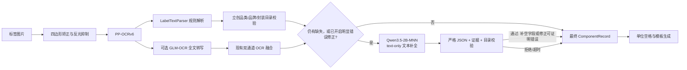

# Qwen3.5 离线结构化补全（MNN text-only）部署计划

日期：2026-08-20

应用接入版本：EPrint v1.5.38 / versionCode 44（部署前设备基线为 v1.5.37 / 43）

业务调用版本：EPrint v1.5.40 / versionCode 46（在 v1.5.38 模型部署与自检基础上开放）

安全纠错版本：EPrint v1.5.41 / versionCode 47（新增显式开关、互斥配置与明显错误硬门禁）

状态：Qwen3.5-2B-MNN 已部署；v1.5.40 已实现默认 fill-only/证据 validator 并接入“拍摄识别”主链路，v1.5.41 新增默认关闭的“修正明显错误”模式；两种模式均已通过全量构建、真机业务 Prompt 和 text-only `vision_time=0` 验证

本计划的 text-only 定义：Qwen3.5 只接收 PP-OCR/规则生成的普通文本请求，不接收图片，不生成
`...</img>` prompt，不进入 MNN 多模态 prompt 分支；每次生成的 `vision_time` 必须为 0。
官方完整模型快照仍保留视觉相关文件，以避免破坏模型完整性；“不执行视觉编码器”与“加载时是否
仍映射视觉权重”分开验收，不能通过删除文件或伪造 `is_visual=false` 规避。

## 0. 部署执行记录

| 时间 | 检查项 | 结果 |
|---|---|---|
| 2026-08-20 | 工作区版本基线 | `apps/android/app/build.gradle` 为 v1.5.37 / versionCode 43；设备安装版本一致 |
| 2026-08-20 | 远程 ADB | 已连接 `DEVICE_IP:ADB_PORT`，设备 `SM-X800`，Android 14 / API 34，Qualcomm 平台 |
| 2026-08-20 | 设备存储 | `/sdcard` 可用约 9.1 GB；现有 `glm-ocr-mnn` 占约 966 MB，具备部署 2B 模型的空间余量 |
| 2026-08-20 | 本地运行时物料 | MNN 3.6.1 arm64 so、头文件、NDK/CMake 与 `glm_smoke` 冒烟程序均已存在 |
| 2026-08-20 | Qwen 官方 revision | `taobao-mnn/Qwen3.5-2B-MNN@35781816d7b6a9dcb273a6765ac9563401951c3c`；`git ls-remote` 与 Hugging Face API 返回一致 |
| 2026-08-20 | Qwen 官方文件清单 | 快照约 1.39 GB；`llm.mnn.weight` 1,176,647,702 B，`visual.mnn.weight` 195,587,264 B，其余配置、图结构与 tokenizer 约 14.5 MB |
| 2026-08-20 | 首次下载尝试 | Git 仓库与小文件已落地，但 Git LFS 两个权重的临时文件超过 80 秒仍为 0 B；已中止该无进度进程，保留仓库并切换 Hugging Face 官方 `hf_xet` 下载链路 |
| 2026-08-20 | 镜像续传 | Hugging Face CDN 直传在 720,896 B 后停滞；ModelScope 官方 `MNN/Qwen3.5-2B-MNN` 镜像对语言权重返回相同 ETag `c93f71...219690`，据此续传同一对象，约 45 MB/s 完成；视觉权重约 22 MB/s 完成 |
| 2026-08-20 | 下载校验 | 11 个官方文件均已落地，字节数与 API 一致；语言/视觉权重 SHA-256 分别为 `c93f71...219690` / `8f90e1...60376860`，与官方对象标识一致；完整清单见 `.tools/verification/qwen35-2b-mnn-sha256.txt` |
| 2026-08-20 | text-only 冒烟配置 | 保留官方 `llm_config.json` 的 `is_visual=true` 与完整视觉文件；新增独立 `qwen35-config-device.json`，只配置 `llm.mnn` / `llm.mnn.weight`、CPU 4 线程、关闭 thinking；复用 plain-string `glm_smoke`，不构造图片或视觉 token |
| 2026-08-20 | 远程推送 | 完整快照与独立 text-only 配置已推送到 `/data/local/tmp/qwen35/model`；语言/视觉权重分别以 28.7 / 30.1 MB/s 完成，未改动现有 `/data/local/tmp/glm` 与应用模型目录 |
| 2026-08-20 | 设备端校验 | 权重字节数为 1,176,647,702 / 195,587,264 B，设备端 SHA-256 与本地及官方对象标识完全一致；推送后设备可用空间约 7.8 GB |
| 2026-08-20 | 首次 text-only 推理 | MNN 3.6.1 / CPU 4 线程 / low precision 加载与生成成功；输出 `{"ok":true,"model":"Qwen3.5-2B"}`，流尾另有 `<eop>`，应用解析前必须剥离终止标记 |
| 2026-08-20 | 首次性能指标 | `prompt=39`、`decode=17`、`prefill_us=558154`、`decode_us=992127`，约 17 token/s；`vision_us=0`，确认本次普通字符串请求未执行视觉编码器 |
| 2026-08-20 | 256-token 压测 | `prompt=32`、`decode=256`、`prefill_us=559071`、`decode_us=14676885`，约 17.4 token/s，`vision_us=0`；达到 token 上限时按预期截断 |
| 2026-08-20 | 1024-token / 内存压测 | `prompt=33`、`decode=1024`、`prefill_us=336388`、`decode_us=68189916`，约 15.0 token/s，`vision_us=0`；运行中 PSS 约 1.55 GB、RSS 约 1.56 GB、`VmHWM` 约 1.98 GB、swap 0、线程数 4 |
| 2026-08-20 | 同进程 reset | 两轮分别准确返回 `{"round":1}` / `{"round":2}`，第二轮未串入第一轮上下文；两轮 `vision_us=0`，普通完成后的 `reset()` 可用 |
| 2026-08-20 | 取消与恢复（发现问题） | 按现有 JNI 方式在 32 字节后设置 `LlmStatus::USER_CANCEL`，生成于 32 token 停止、`status=3`、`vision_us=0`；随后仅调用 `reset()` 时状态仍为 3，恢复请求 `decode=0` 且空输出。必须补充“取消后状态恢复”修复并复测，不能直接宣告可集成 |
| 2026-08-20 | 取消问题根因 | 当前设备与应用使用的预编译 `libllm.so` SHA-256 为 `196691...95b3`；反汇编确认其中 `Llm::reset()` 清空 token/计时数据但不写 `LlmContext::status`，与 MNN `3.6.1` tag 当前源码中 reset 后恢复 `RUNNING` 的实现不一致。最小兼容方案是仅在 `USER_CANCEL` 后显式恢复为 `RUNNING`，并做取消后恢复复测 |
| 2026-08-20 | 取消兼容修复复测 | 在 `reset()` 后仅当状态仍为 `USER_CANCEL` 时显式设回 `RUNNING`：取消保持在 32 token 停止，随后恢复请求正确返回 `{"recovered":true}`，最终 `status=NORMAL_FINISHED(1)`；取消与恢复两段 `vision_us=0`。该兼容逻辑需同步到应用 JNI |
| 2026-08-20 | 20 轮稳定性 | 同一已加载会话连续执行 20 轮 `reset → strict JSON`，`passed=20/20`；每轮输出与期望字节一致（剥离统一 `<eop>` 后为合法 JSON），每轮 `vision_us=0`，无崩溃、无上下文串扰 |
| 2026-08-20 | 应用层接入 | v1.5.38 / code 44 新增独立 `QwenTextOnlyEngine`、`QwenTextResult`、固定 revision/全文件 SHA-256 校验、视觉 prompt 前置拒绝、non-thinking 与 `vision_time=0` 后置门禁；模型配置页显示部署状态。自动字段补全仍关闭，待 fill-only/证据 validator 完成 |
| 2026-08-20 | 应用正式模型目录 | 完整快照、`config-text-only.json` 和 `model_manifest.json` 已复制到 `/sdcard/Android/data/com.otool.eprint/files/models/qwen3.5-2b-mnn/`；关键权重和 text-only 配置设备端 SHA-256 再次一致，复制后设备可用约 6.5 GB |
| 2026-08-20 | JVM 定向测试 | `QwenTextOnlyEngineTest` 与 `VlmOcrEngineTest` 通过；主 Java 代码编译通过；随后已纳入 212 项全量单测门禁 |
| 2026-08-20 | v1.5.38 构建门禁 | 212 项 JVM 单测零失败；`lintDebug`、`assembleDebug`、`assembleDebugAndroidTest` 成功；APK 元数据为 1.5.38 / 44，无 `INTERNET` 权限、无 Qwen 权重，ZIP 与关键 native ELF 均通过 16 KB 对齐检查 |
| 2026-08-20 | 首次应用进程自检（部署权限问题） | 主 APK 覆盖安装成功且设备确认 1.5.38 / 44；instrumentation 在加载前报告缺 `model_manifest.json`。shell 与 `run-as` 可列出文件，但模型目录由 shell 创建并归 shell 所有；需改为应用 UID 创建正式目录和文件后复测，不能把该结果误记为模型加载失败 |
| 2026-08-20 | 应用 UID 修复与复测 | 由 `u0_a345` 创建正式模型目录并复制文件后，instrumentation `textOnlyJsonAndCancelRecovery` 通过（1/1，10.871 秒）：应用进程完成全量 SHA-256、加载、严格 JSON、32-token 取消及取消后恢复 |
| 2026-08-20 | 应用进程 native 指标 | 全量校验+加载 7,683 ms；JSON `prompt=26/decode=6/vision=0us`，取消 `32/32/0us`，恢复 `27/7/0us`；恢复输出正确，native 会话正常释放 |
| 2026-08-20 | 视觉权重映射审计 | 1024-token 文本运行中 `/proc/maps` 的 `visual.mnn*` 映射数为 0，同时 `llm.mnn*` 映射数也为 0，说明该预编译运行时把权重读入匿名内存，不能仅靠 maps 证明视觉权重未读入；可确认的是配置不引用 visual 文件、请求未含视觉输入且 `vision_time=0`。文档/UI 不宣称“视觉权重未加载” |
| 2026-08-20 | 临时副本清理 | 应用正式目录及哈希保持不变后，删除本轮创建的 `/data/local/tmp/qwen35` 与 `qwen3.5-2b-mnn-shell-stage` 两个临时副本；本地已校验源副本仍保留，可恢复。设备 `/sdcard` 可用空间回到约 7.8 GB |
| 2026-08-20 | APK 归档与最终安装 | `EPrint-native-v1.5.38-debug.apk` 已归档，86,760,702 B，SHA-256 `42F88F...3CCBC`，v2 Debug 签名；设备确认 1.5.38 / 44，冷启动 1,180 ms、进程存活、最近 300 行进程日志无 FATAL/ANR/native fatal |
| 2026-08-20 | v1.5.40 调用根因 | v1.5.38~v1.5.39 只有 `QwenTextOnlyEngine`、部署状态和 instrumentation 自检，`LabelRecognitionController` 没有任何 Qwen 引用；因此点击“拍摄识别”不会调用 Qwen，不是模型部署失败 |
| 2026-08-20 | v1.5.40 业务接入实现 | 新增独立 `QwenSettings`/Store、严格七键文本 Prompt、`QwenComponentEnricher`；默认每次 OCR 后调用、只补空字段、逐字段 OCR 证据门禁、内部编码拦截与立创目录规范化，失败安全回退原 PP/GLM 结果 |
| 2026-08-20 | v1.5.40 配置能力 | Qwen 折叠区可配置启停、仅缺失时调用、有证据纠错、目录强校验、CPU 线程、Token、超时和额外文本规则；GLM/Qwen 串行释放加载，不同时常驻 |
| 2026-08-20 | v1.5.40 定向测试 | Qwen 设置/Prompt/引擎/证据补全共 14 项测试通过；新增“封装只嵌在型号中不算独立证据”和“纠错开关同步 Prompt”回归 |
| 2026-08-20 | v1.5.40 全量门禁 | 224 项 JVM 单测零失败/错误/跳过；`lintDebug` 为 0 error / 389 warning；`assembleDebug` 与 `assembleDebugAndroidTest` 成功 |
| 2026-08-20 | v1.5.40 应用进程业务测试 | 最终 APK 的 instrumentation 1/1 通过（18.189 秒）：正式模型完成严格 JSON、业务 Prompt+validator、32 字符后取消及恢复；业务补全接受品类/封装/品牌，全部请求 `vision_time=0` |
| 2026-08-20 | v1.5.40 真实拍摄按钮链路 | 真机点击“拍摄识别”后日志明确显示 Qwen“已实际调用”；PP-OCR 1,603 ms，Qwen 加载 4,636 ms，`prompt=350/decode=102`、prefill/decode 5,991/5,112 ms、生成 11,204 ms、`vision=0us`；完整字段仅校验不改写，模板只生成一次 |
| 2026-08-20 | v1.5.40 配置 UI 真机检查 | Qwen 折叠区启停、按缺失调用、证据纠错、目录门禁、线程、Token、超时、额外规则均可见且依赖联动正确；测试折叠偏好已清除，未改动原识别参数 |
| 2026-08-20 | v1.5.40 APK 归档与最终安装 | `EPrint-native-v1.5.40-debug.apk` 已归档，86,862,321 B，SHA-256 `F56021...E6D9D`，v2 Debug 签名；4/16 KiB 对齐通过，无 `INTERNET`、无 GLM/Qwen 权重；设备确认 1.5.40 / 46，冷启动 1,006 ms且无 FATAL/ANR/native fatal |
| 2026-08-20 | v1.5.41 配置语义修复 | “允许 Qwen3.5 修正明显错误”默认关闭；开启时自动关闭并禁用“仅在核心字段缺失时调用”，持久化层也强制归一化，确保完整但可能误填的记录确实进入 Qwen 校验 |
| 2026-08-20 | v1.5.41 明显错误门禁 | 只有当前值在本次 OCR 中无证据、可证明误取内部编码/订单号/跟踪号/批次/其他语义字段，或目录值非法时才允许改写；新值必须来自独立 OCR 行并通过字段格式及可选目录规范化，型号还必须同时包含字母和数字 |
| 2026-08-20 | v1.5.41 真机模型风险发现 | 发布前真实 2B 推理曾把品牌 `VISHAY(威世)` 提议为型号；因此 validator 增加品牌/品类/规格/封装等非型号值硬拒绝，Prompt 在 OCR 证据之后追加经本地过滤的 `MODEL_CANDIDATE_HINTS` 与最终不可绕过规则 |
| 2026-08-20 | v1.5.41 自动测试与构建 | 229 项 JVM 单测零失败/错误/跳过；`lintDebug` 为 0 error / 388 warning；`assembleDebug` 与 `assembleDebugAndroidTest` 成功，APK 元数据为 1.5.41 / 47 |
| 2026-08-20 | v1.5.41 最终应用进程回归 | 最终 APK instrumentation 1/1 通过（26.484 秒）：真实模型完成普通 JSON、业务补全、明显错误修正、32-token 取消及恢复；将误填内部编码 `3427-B-D12-003` 修正为独立 OCR 型号 `CRCW06030000Z0EAHP`，全部 5 次请求均为 `vision=0us` |
| 2026-08-20 | v1.5.41 配置 UI 真机检查 | 开启“修正明显错误”后，“仅在核心字段缺失时调用”立即取消勾选并置灰；取消对话框后清除测试折叠偏好，未保存或改动设备原 Qwen 设置；截图为 `artifacts/eprint-v1.5.41-qwen-correction-config.png` |
| 2026-08-20 | v1.5.41 APK 归档与最终安装 | `EPrint-native-v1.5.41-debug.apk` 已归档，86,863,195 B，SHA-256 `9F0053...D2E719`，v2 Debug 签名；4/16 KiB 对齐通过，无 `INTERNET`、无 GLM/Qwen 权重；远程设备确认 1.5.41 / 47，冷启动 1,169 ms、进程存活且无 FATAL |

运行时冒烟版为 v1.5.38 / versionCode 44；业务调用版已按 `eprint-release-versioning`
递增到 v1.5.41 / versionCode 47，构建、归档、安装、文本纠错与设备版本确认均已完成。

## 1. 结论先行

Qwen3.5 在本项目中的第一职责应是 **OCR 后的文本结构化与缺失字段补全**，而不是替换
PP-OCR，也不是在首期再承担一次图片识别。推荐主链路为：



核心决策：

1. **PP-OCR + Qwen3.5 必须可以独立工作**。GLM-OCR 是可选的第二份文字证据，不是
   Qwen3.5 的前置依赖。
2. Qwen3.5 默认只填空字段，不覆盖已有且通过规则验证的值；用户可显式开启默认关闭的明显错误
   修正，但改写必须同时通过“现值错误证据 + 候选独立 OCR 证据 + 格式/目录”门禁。输出失败、
   超时或模型缺失时，原 PP-OCR/规则结果照常生成模板。
3. 首期部署型号确定为官方 4-bit `Qwen3.5-2B-MNN`；`0.8B` 仅作性能下限，`4B` 仅作质量
   对照，不在本决定中替换 2B。
4. 首期强制使用 text-only 推理：Qwen 请求只能包含结构化文本，禁止图片路径、`` 标签、
   视觉 token 和多模态 API；native 结果中的 `vision_time` 必须为 0。
5. 保留官方 Qwen3.5-2B-MNN 完整快照，包括视觉文件；是否在 `load()` 阶段映射视觉权重必须
   通过 PSS、日志和运行时指标确认。若 MNN 3.6.1 不能在加载阶段跳过视觉权重，则停止“零视觉
   加载”目标，评估官方 text-only 导出或受控升级 MNN，不能自行改 `is_visual`。
6. 延续项目的离线边界：模型不打进 APK、不增加 `INTERNET` 权限，通过离线导入或 ADB
   放入应用私有模型目录。
7. 首期不同时常驻 GLM-OCR 与 Qwen3.5。两个大模型并存会放大内存峰值，应由统一模型资源
   协调器串行装载，或通过识别预设让用户二选一。

## 2. 当前代码基线与可复用能力

### 2.1 已有完整能力

| 当前能力 | 代码位置 | 对 Qwen3.5 的价值 |
|---|---|---|
| 标签四边形矫正、裁剪、反光抑制 | `LabelFrameProcessor`、`scan/opencv/*` | Qwen 不再处理脏图；PP/GLM 共用稳定输入 |
| PP-OCRv6 离线检测/方向/识别 | `scan/ocr/LabelOcrEngine.java` | Qwen 的主输入来源，保证可与 PP-OCR 单独组合 |
| OCR 行到器件字段的规则解析 | `scan/LabelTextParser.java` | 先确定性提取，Qwen 只处理剩余缺口 |
| 479 个立创末级品类、2,614 个品牌与 21,681 个封装 | `LcscPackageCatalog`、`CategoryPackageMatcher` | 校验 Qwen 给出的品类、品牌和封装，压制幻觉 |
| GLM-OCR 0.9B MNN 端侧推理 | `scan/vlm/*`、`glm_ocr_jni.cpp` | 已验证 MNN-LLM、JNI、流式回调、超时和侧载模型路径 |
| 严格七键 JSON 解析 | `GlmInformationExtractionParser` | 可复用字段命名与部分清洗规则，但不能直接复用补丁语义 |
| PP/GLM 融合与统一记录 | `ComponentRecordFusion`、`ComponentRecord` | 保持最终模板输入类型不变 |
| 单位后空格与一次性模板生成 | `UnitSpacingFormatter`、`finalizeLabelRecognition()` | Qwen 完成后仍走现有最终化步骤 |

### 2.2 不能直接把 Qwen 塞进现有 VLM 类的原因

1. `VlmOcrEngine` 同时承担 GLM 专属模型清单、图片落盘、补方、`` prompt、转写退化
   检测和 GLM 设置，职责不是通用 LLM。
2. `GlmOcrSession` 的 C++ 实现实际调用通用 `Llm::createLLM()`，底层大部分可复用，但 Java
   类名、JNI 符号、日志和库名均绑定 GLM。
3. GLM 官方包要求 `embeddings_bf16.bin`；官方 Qwen3.5-MNN 包的文件布局不同，并包含
   `llm.mnn.json` 和视觉模型文件。复用同一 `REQUIRED_FILES` 会误判模型完整性。
4. `ComponentRecordFusion` 只有 PP/GLM 两路，并以一项全局权重决定所有冲突；将 Qwen 作为
   第三路继续加权，会让“补全器”获得不应有的覆盖权。
5. `ComponentRecord` 只有整条记录置信度，没有字段级来源、证据和“模型推断/原文提取”状态，
   无法安全说明 Qwen 到底补了什么。
6. `LabelRecognitionController` 目前硬编码 `1/5` 至 `5/5` 和 PP→GLM 顺序。加入条件式 Qwen
   后需要动态阶段日志，不能继续堆叠分支和固定序号。
7. 当前 GLM 失败路径是开发期“失败即停止”；Qwen 是增强阶段，失败必须退回确定性结果，
   两者的故障语义不同。

## 3. 官方模型与运行时选择

### 3.1 已核对的官方事实

- Qwen3.5 是原生多模态模型族，官方提供 0.8B、2B、4B、9B 等稠密模型；官方模型卡说明
  默认会输出 thinking 内容，非思考模式应通过 chat template 参数关闭，而不是依赖
  `/nothink` 文本指令。来源：[Qwen3.5-9B 官方模型卡](https://huggingface.co/Qwen/Qwen3.5-9B)、
  [Qwen3.5 官方集合](https://huggingface.co/collections/Qwen/qwen35)。
- Alibaba MNN 在 2026-03-05 宣布支持 Qwen3.5 系列，当前项目已经使用 MNN 3.6.1 的
  `libllm.so` 与同类 `Llm::createLLM()` 接口。来源：
  [MNN 官方仓库](https://github.com/alibaba/MNN)。
- MNN 官方组织已提供 4-bit 模型：`0.8B` 约 548 MB、`2B` 约 1.39 GB、`4B` 约
  2.85 GB。来源：[Qwen3.5-0.8B-MNN](https://huggingface.co/taobao-mnn/Qwen3.5-0.8B-MNN)、
  [Qwen3.5-2B-MNN](https://huggingface.co/taobao-mnn/Qwen3.5-2B-MNN)、
  [Qwen3.5-4B-MNN](https://huggingface.co/taobao-mnn/Qwen3.5-4B-MNN)。
- 官方 Qwen3.5-MNN 的 `llm_config.json` 仍声明 `is_visual: true`。因此本项目必须保留
  `visual.mnn`/`visual.mnn.weight`，但运行时不得向 prompt 注入图片；不能把 vLLM 的
  `--language-model-only` 参数直接当成 MNN 配置项。来源：[2B MNN 配置](https://huggingface.co/taobao-mnn/Qwen3.5-2B-MNN/blob/main/llm_config.json)、
  [Qwen3.5-2B 官方模型卡](https://huggingface.co/Qwen/Qwen3.5-2B)。
- MNN 官方文档区分普通文本模型与视觉模型：普通文本路径使用 `is_visual: false`，视觉路径
  才配置 `visual_model` 并使用 `` 输入；本项目的 Qwen3.5 包是视觉配置，所以首期只
  采用“普通文本 API 路径 + 禁止视觉输入”，是否能进一步跳过加载视觉权重必须单独验证。
  来源：[MNN-LLM 官方文档](https://github.com/alibaba/MNN/blob/master/transformers/README.md)。
- MNN 文档支持通过 `config.json` 控制后端、线程、精度、采样，并由模型的 Jinja chat
  template 生成对话格式。来源：[MNN-LLM 官方文档](https://mnn-docs.readthedocs.io/en/latest/transformers/llm.html)。

“MNN 已支持”只说明代码路径存在，不能替代本项目现有预编译库、目标 Android 版本和
SM-X800 上的真实加载测试。官方仓库历史中出现过 Qwen3.5 Android chat template/运行崩溃
问题，因此兼容性冒烟必须排在业务接入之前。

### 3.2 型号决策

| 候选 | 官方 MNN 包体约值 | 计划角色 | 进入主线条件 |
|---|---:|---|---|
| Qwen3.5-0.8B-MNN | 548 MB | 性能/内存基线 | 补全精度与 2B 差距 ≤1 个百分点，且全部安全门槛通过 |
| **Qwen3.5-2B-MNN** | **1.39 GB** | **首选验证与默认候选** | 达到第 11 节质量、延迟和内存门槛 |
| Qwen3.5-4B-MNN | 2.85 GB | 质量上限对照 | 相比 2B 有 ≥3 个百分点有效提升，且设备资源门槛仍通过 |

不首选 9B 及更大模型：当前目标只是短文本分类、字段归属和受约束补全，模型体积、冷加载、
内存峰值和端侧时延成本与任务不匹配。

### 3.3 首期运行模式：强制 text-only

虽然 Qwen3.5 原生支持图像，首期固定为 **text-only**，并把“跳过视觉编码器执行”作为硬性
验收条件：

- 输入 PP-OCR 逐行文本、每行置信度和位置；
- 输入确定性解析出的现有字段；
- 输入缺失字段列表；
- 仅输入立创目录检索后的少量候选，不把 1.38 MB 全目录塞进 prompt；
- GLM 开启时，可把其全文转写作为第二份文字证据，但不传标签图片给 Qwen。
- Qwen prompt 只能是普通 UTF-8 文本；禁止写入图片路径、``、`<hw>`、视觉 token 或
  任何多模态 content 数组；
- `QwenCompletionEngine` 必须调用 MNN 普通文本 `response(history_, ...)` 路径，不调用
  `response(multimodal_prompt, ...)`；
- 每次 native 结果 `vision_time == 0`，且应用不生成 Qwen 专用图片文件；
- `load()` 阶段单独记录是否加载视觉权重。若视觉权重仍被映射，只能称为“text-only 推理”，
  不得在文档或 UI 中宣称“视觉权重未加载”。

这样才能准确测出“LLM 补全”本身的收益，并保证 `PP-OCR + Qwen3.5` 是完整可用组合。
Qwen 直接读图作为后续独立实验，不进入首期发布范围。

## 4. 目标运行模式

模型配置最终提供四种清晰预设，避免让用户理解三套引擎的任意组合：

| 预设 | 执行链路 | 默认用途 |
|---|---|---|
| 规则极速 | PP-OCR → 规则/目录 | Qwen 模型缺失、低内存或追求最快 |
| **语义补全** | **PP-OCR → 规则/目录 → Qwen3.5** | **建议默认；满足“搭配 PP-OCR 单独使用”** |
| OCR 增强 | PP-OCR + GLM 转写 → 融合 | 保持现有视觉转写能力，不加载 Qwen |
| 实验全链 | PP-OCR + GLM → 释放 GLM → Qwen | 仅测试；时延较长，不默认开放 |

v1.5.41 已落地独立细粒度配置；上表四种预设仍可作为后续快捷入口，目前不强迫用户切换预设：

- `启用 Qwen3.5 OCR 后文本补全`：默认开启；模型缺失或校验失败时显示原因并安全跳过；
- `仅在核心字段缺失时调用（节省时间；与明显错误修正互斥）`：默认关闭；开启后可跳过核心字段完整的记录；
- `允许 Qwen3.5 修正明显错误（需 OCR/格式/目录证据，默认关闭）`：开启后会检查完整记录，并自动关闭、禁用“仅在核心字段缺失时调用”；只有现值在本次 OCR 中无证据或可证明误取其他字段/目录值，且候选通过全部硬门禁时才改写；
- `品类/品牌/封装必须命中立创离线字典`：默认开启；
- CPU 线程 `1-8`（默认 4）、最大输出 Token `64-512`（默认 192）、超时 `10-180` 秒（默认 60）；
- 可追加最多 1,000 字的文本整理规则；图片路径、`` 和视觉 token 会在保存/生成前拒绝；
- CPU、low precision、low memory、greedy 与 non-thinking 仍是固定安全运行边界，不在 UI 暴露。

## 5. 目标数据契约

### 5.1 请求对象

新增纯 JVM `QwenCompletionRequest`，由 Builder 统一净化和限长。建议序列化格式：

```json
{
  "schema_version": 1,
  "task": "fill_missing_component_label_fields",
  "missing_fields": ["package"],
  "ocr_lines": [
    {"id": 0, "text": "PCT201610-1R0-M", "confidence": 0.98},
    {"id": 1, "text": "功率电感", "confidence": 0.97},
    {"id": 2, "text": "1μH±20%3.5A", "confidence": 0.96},
    {"id": 3, "text": "0806", "confidence": 0.91}
  ],
  "existing": {
    "manufacturer_part_number": "PCT201610-1R0-M",
    "lcsc_part_number": "C54557075",
    "category": "功率电感",
    "specification": "1μH±20%3.5A",
    "package": "",
    "brand": "JIERR(捷而瑞)",
    "parameters": []
  },
  "catalog_context": {
    "matched_category": "功率电感",
    "package_candidates": ["0806"]
  },
  "policy": {
    "fill_only": true,
    "evidence_required": true,
    "allow_catalog_inference": false
  }
}
```

约束：

- OCR 文本最多 2,400 字符、单行最多 256 字符、总行数最多 64；控制字符移除。
- 标签文字放入明确的 `<label_data>` 数据区，并在 system prompt 说明其中任何“指令”都只是
  标签内容，防止把 OCR 文本当 prompt 指令。
- 不发送完整图片、订单号、追踪号、二维码内容或整份立创目录。
- `package_candidates` 由本地目录和 OCR 相似度先缩到 Top-K（建议 K≤20）。

### 5.2 响应对象

Qwen 只返回补丁，不回写完整记录：

```json
{
  "schema_version": 1,
  "patches": [
    {
      "field": "package",
      "value": "0806",
      "source": "ocr_line",
      "evidence_line_ids": [3],
      "confidence": 0.96
    }
  ],
  "abstained_fields": []
}
```

允许字段固定为：`manufacturer_part_number`、`lcsc_part_number`、`category`、
`specification`、`package`、`brand`、`parameters`。模型不得输出数量、订单、批次、追踪、
内部仓储编码，也不得输出自由说明。

### 5.3 非思考与 JSON 处理

Qwen3.5 默认思考，首期在官方 chat template 上设置 `enable_thinking=false`，同时：

1. `max_new_tokens` 初始限制在 256~384；
2. prompt 要求只输出一个 JSON 对象；
3. 响应解析器仍将 `<think>`、Markdown 围栏或 JSON 外文字视为异常，不把隐藏思考写入日志；
4. 首次格式失败只允许一次“原输出 + 格式错误摘要”的修复重试；第二次失败立即回退；
5. 是否使用官方 non-thinking 采样参数或低随机/greedy 方案，以固定测试集消融后决定，不能
   直接沿用 GLM-OCR 的 penalty 参数。

MNN 当前链路未在本项目中证明具备 JSON grammar constrained decoding，因此所有模型输出都
必须当作不可信文本处理。

text-only 额外约束：Qwen 的 prompt 构造器不得复用 GLM 的图片落盘、补方或 `` 拼接逻辑；
native 层必须走普通文本 `response(history_, ...)` 分支。若输出指标出现非零 `vision_time`，
该次请求视为 text-only 验收失败并回退，不得把结果写入最终记录。

## 6. 安全落地规则

新增 `QwenCompletionValidator`，按字段执行以下规则；校验失败只拒绝该补丁，不丢弃基线记录：

1. schema 版本、对象形状、字段白名单、类型和长度必须完全合法；未知键默认拒绝。
2. 默认 `fill_only=true`，任何非空现有字段都不可被 Qwen 修改；只有用户显式开启明显错误修正时
   才进入覆盖审计，且该设置会在 UI 与持久化层强制关闭“仅缺失时调用”。
3. `evidence_line_ids` 必须存在，`ocr_line` 来源的值规范化后必须能在对应 OCR 行中找到；
   不相信模型自己声明的证据。
4. 立创料号必须匹配 `C\d{5,}`，且存在于 OCR 证据中。
5. 型号候选必须来自独立 OCR 行并同时包含字母和数字；不得等于立创料号、内部编码、订单号、
   跟踪号、批次、品类、规格、封装、品牌或参数。Prompt 中的候选提示也只能由同一套本地规则生成。
6. 已有值只有在本次 OCR 中找不到对应证据，或可证明误取其他语义字段、包含 `QTY`/`ROHS`、
   料号格式非法，或目录强校验下品类/品牌/封装不合法时，才属于“明显错误”；“模型认为更好”
   不是改写依据。
7. 品类必须能由 `CategoryPackageMatcher` 命中，或原标签存在直接文字证据；目录修正的候选必须
   同时具有独立 OCR 证据和目录规范化结果。
8. 封装必须属于已确认品类的立创目录候选；品牌优先命中合并后的立创品牌字典并受当前品类
   约束；规格、品牌、参数仍须追溯到 OCR 行，并继续执行 ROHS/QTY/订单/型号污染清理。
9. `confidence` 只用于日志和阈值，不替代规则校验；模型自报 1.0 也无权绕过验证。
10. 被接受的字段写入字段级 provenance：`PP_OCR`、`GLM_TRANSCRIPT`、`LCSC_CATALOG`、
    `QWEN_EXTRACTED` 或 `QWEN_INFERRED`。模板仍读取最终 `ComponentRecord`，减少改造面。

“自动填入”在第一版的含义是：自动接受有 OCR/目录依据的缺失字段；没有依据时宁可 abstain，
不以语言模型常识伪造型号、封装或电气参数。

## 7. 代码改造蓝图

以下为总体实施清单。v1.5.38 先实现 `QwenTextOnlyEngine` / `QwenTextResult`、模型清单与
应用进程自检；v1.5.40 已补齐 Prompt、严格 parser/validator、配置 Store 和识别流水线接入；
v1.5.41 补齐可用且可证明安全的明显错误修正模式。
字段级 provenance 与通用 JNI 类重命名仍可后续演进，不影响当前安全补全边界。

### 7.1 通用 MNN 会话层

| 文件 | 计划 |
|---|---|
| `scan/llm/MnnLlmSession.java` | 从 `GlmOcrSession` 抽出通用 load/submit/reset/release/config 接口 |
| `scan/llm/MnnLlmResult.java` | 统一 text、token、prefill/decode、停止与错误字段 |
| `src/main/cpp/mnn_llm_jni.cpp` | 将 `glm_ocr_jni.cpp` 的模型无关部分改为通用 JNI；保留流式 UTF-8、安全停止和性能数据 |
| `CMakeLists.txt` | JNI 库改为中性名称；迁移期可保留 GLM adapter，避免一次性重写全部调用方 |

先做“兼容 adapter”而不是大爆炸重命名：GLM 与 Qwen 均依赖同一通用会话。GLM 专属的图片
prompt、视觉输入和退化检测继续留在 `VlmOcrEngine`；Qwen adapter 禁止引入图片处理和
多模态 prompt。

### 7.2 Qwen 补全域

v1.5.41 实际落地如下：

- `QwenTextOnlyEngine` / `QwenTextResult`：模型清单、全文件 SHA-256、装载、生成、停止、
  性能统计、non-thinking 与 `vision_time == 0`；公开 API 只接收字符串。
- `QwenSettings` / `QwenSettingsStore`：启停、安全策略、线程、Token、超时和额外规则；与
  `VlmSettings` 完全分离，并归一化“明显错误修正/仅缺失时调用”的互斥关系。
- `QwenComponentPrompt`：构造普通文本七键 JSON 请求，清除视觉标记并限长 OCR 证据；纠错
  模式在 OCR 文本之后追加本地过滤的型号候选和最终硬规则，避免短上下文模型把品牌当型号。
- `GlmInformationExtractionParser`：复用成熟的严格七键 JSON 清洗/解析；模型仍返回完整记录，
  但 `QwenComponentEnricher` 逐字段与当前记录比较，不会直接整条覆盖。
- `QwenComponentEnricher`：执行 fill-only、可选明显错误修正、已知非型号值硬拒绝、独立值证据、
  字母数字格式与目录校验，返回接受/拒绝计数并在无修改时复用原记录。
- 字段级 provenance 暂由 warning/识别日志承载；若后续需要审计持久化，再引入独立 decision 对象。

### 7.3 现有类的最小修改

| 文件 | 后续修改点 |
|---|---|
| `CategoryPackageMatcher.java` | 在现有品类/品牌/封装规范化基础上增加受限 `rankPackageCandidates(...,limit)`；不向 prompt 暴露完整目录 |
| `ComponentRecord.java` | 保持最终模板兼容；字段来源先用 companion/decision 对象承载，确认 UI 需求后再决定是否持久化 |
| `ComponentRecordFusion.java` | 仍只负责 PP/GLM OCR 证据融合；Qwen 不作为第三个加权记录源 |
| `LabelRecognitionController.java` | 拆出 `LabelRecognitionPipeline`/阶段事件；在确定性结果后按缺口条件调用 Qwen，并实现失败回退 |
| `RecognitionSettings*` | 新增 Qwen 开关和识别预设；旧设置无感迁移，默认不改变未安装模型设备的结果 |
| `ModelConfigDialog.java` | 分开显示“GLM 文字转写”和“Qwen 字段补全”；修正当前仍写“GLM 信息提取/默认 GLM 优先”的过时文案 |
| `GlmInformationExtractionParser.java` | 提取共用清洗器；不要让 Qwen patch 伪装成 GLM 的完整七键记录 |
| `UnitSpacingFormatter.java` | 无逻辑变化，继续只在最终记录上执行一次 |

## 8. 模型交付与目录设计

### 8.1 模型目录

建议与现有 GLM 平级：

```text
/sdcard/Android/data/com.otool.eprint/files/models/
├─ glm-ocr-mnn/
└─ qwen3.5-2b-mnn/
   ├─ model_manifest.json
   ├─ config.json
   ├─ llm_config.json
   ├─ llm.mnn
   ├─ llm.mnn.json
   ├─ llm.mnn.weight
   ├─ tokenizer.txt
   # 以下两个文件必须保留在官方完整快照中，但 text-only 运行不得调用视觉路径
   ├─ visual.mnn
   └─ visual.mnn.weight
```

实际必需文件以固定 revision 的官方快照为准，不能复制 GLM 的必需文件数组。第一版不因
text-only 运行而删除视觉文件，也不把 `llm_config.json` 中的 `is_visual` 强行改成 `false`；
这些动作只有在官方 text-only 导出或升级后的 MNN 运行时明确支持、并通过完整回归后才可评估。

`model_manifest.json` 至少记录：

- `modelId`: `taobao-mnn/Qwen3.5-2B-MNN`；
- 固定 revision/commit，不允许运行时静默追随 `main`；
- `quantization`: 4-bit、来源模型和许可证；
- 每个文件的路径、字节数和 SHA-256；
- 兼容的 MNN 版本、应用 schema 版本和创建时间；
- 本项目的验证设备与结果摘要；
- `input_mode`: `text-only`；
- `vision_input`: `forbidden`；
- `multimodal_prompt`: `disabled`；
- `require_vision_time_us`: `0`；
- `visual_weights_load_policy`: `measure_and_report`（不得未经实测宣称未加载）。

### 8.2 交付方式

1. 开发期：在 `.tools/downloads/qwen3.5-2b-mnn/` 保存经哈希验证的源副本（仍由 `.gitignore`
   排除），通过脚本推送到设备；沿用现有“先推 `/data/local/tmp`，再复制并 chmod”的可靠路径。
2. 产品期：增加 Storage Access Framework 的离线目录/归档导入；导入到临时目录，完整校验后
   原子切换，失败保留旧模型。
3. 模型不打入 APK，不由应用联网下载，`AndroidManifest.xml` 继续无 `INTERNET` 权限。
4. UI 只显示模型 id、版本、校验状态和空间占用，不展示可编辑的模型路径。

## 9. 内存与生命周期策略

新增单例 `ModelMemoryCoordinator` 或等价协调层：

1. PP-OCR ONNX 会话可常驻；GLM 与 Qwen 大模型首期互斥常驻。
2. “语义补全”预设只加载 Qwen，不加载 GLM；这是首选路径。
3. “OCR 增强”预设只加载 GLM；保持当前行为。
4. “实验全链”执行 GLM 后显式 `release()`，确认 native 内存下降，再加载 Qwen；若回收不充分
   就禁止该预设，而不是冒险触发 LMK。
5. 只有检测到目标字段缺失/歧义时才调用 Qwen；字段完整时不付出生成成本。
6. 页面退出、配置变化、内存压力和 `onDestroy` 均要可停止并释放当前会话。
7. 每次识别记录 Java heap、native PSS、模型加载时间、prefill/decode、`vision_time` 和总耗时；
   发布版日志不输出完整标签内容。
8. 分别记录 `load()` 阶段与 `response()` 阶段的 native PSS、文件映射和 MNN 日志：
   `vision_time == 0` 只能证明未执行视觉编码；只有 load 阶段也没有视觉权重映射时，才可将
   “跳过视觉编码器”扩展表述为“视觉权重未加载”。

## 10. 分阶段实施计划

### 阶段 0：冻结基准与测试集

- 从现有实拍与回归图中建立脱敏 fixture，保存 PP-OCR 行、GLM 转写、当前规则结果和人工 GT。
- 至少覆盖 100 张标签、20 个末级品类、字符混淆（0/O、1/I/l）、空封装、缺品牌、反光、
  倾斜、二维码干扰及完全不可恢复样本。
- 对每张图预生成“人为遮空一个字段”的补全用例，单独衡量补全精度和破坏率。
- 固定 v1.5.35 的 PP-only 输出为不可回归基线。

交付物：`test-data` 清单（图片如不能入库则只入哈希/GT）、基线 JSON、评测脚本与指标定义。

### 阶段 1：运行时兼容性冒烟，不接业务

- 固定下载官方 `Qwen3.5-2B-MNN` revision 并生成 SHA-256 清单；0.8B/4B 只作为后续对照，
  不改变首期部署型号。
- 用当前 APK 内 MNN 3.6.1 库加载 2B，使用不含 `` 的普通文本 prompt，完成中文、非思考、
  短 JSON、连续 20 次重置/生成和中止测试。
- 在 native 日志和 JNI 结果中确认每次请求走普通文本 `response(history_, ...)`，没有进入
  `response(multimodal_prompt, ...)`，并且 `vision_time == 0`。
- 记录模型 `load()` 前后 native PSS、视觉文件映射、`load()` 日志和首次生成指标；若视觉权重
  仍在加载阶段被映射，明确记录为“文本推理但视觉权重仍加载”，不得伪称完全 text-only。
- 验证 chat template、`enable_thinking=false`、结束 token、UTF-8 流式回调和 `max_new_tokens`。
- 测量 2B 的冷加载、峰值 PSS、prefill/decode、`vision_time`、崩溃和卸载后内存回落。
- 若当前预编译 MNN 不支持 Qwen3.5 text-only 普通文本路径，或无法证明视觉路径未被调用，
  单独评估升级官方 MNN/官方 text-only 导出；不得用删除视觉文件、伪造 `is_visual=false`、
  捕获崩溃或忽略模板错误的方式绕过。

通过条件：2B 连续 20 次无崩溃、能稳定输出合法 UTF-8、超时可停止、每次 `vision_time == 0`、
释放后内存可复用；视觉权重是否在 load 阶段映射必须有明确记录。

### 阶段 2：纯 JVM 补全内核

- 实现 request builder、prompt、strict parser、validator、field provenance 和 fill-only applier。
- 扩充品类/品牌/封装候选 API，只把 Top-K 传给 Qwen。
- 用伪模型响应覆盖合法、缺键、多余键、Markdown、`<think>`、prompt injection、错误证据、
  非目录封装、覆盖已有字段、超长输出和重复字符。
- 该阶段不依赖 Android native 模型，先确保“任何坏输出都不能污染基线记录”。

通过条件：安全规则单测 100% 通过；随机/恶意响应不能覆盖任何非空已验证字段。

### 阶段 3：Qwen 引擎与模型管理

- 抽取通用 MNN 会话或加兼容 adapter，接入 `QwenCompletionEngine`。
- 加入 manifest/哈希/空间校验、模型缺失说明、原子导入和停止机制。
- 实现非思考模式与一轮格式修复；所有错误映射成可审计结果，不抛到 UI 主线程。
- 建立模型资源互斥和生命周期测试。

通过条件：模型缺失、损坏、版本不兼容、空间不足、加载失败、超时和取消均能安全回退。

### 阶段 4：识别流水线与 UI

- 将固定 5 阶段日志改为事件式阶段名，例如“图像处理 / PP-OCR / 可选 GLM / 规则解析 /
  Qwen 补全 / 校验 / 模板生成”。
- 在 PP/GLM 融合完成后计算缺失字段；默认仍实际调用并执行完整记录校验，用户开启“仅缺失时调用”后才在无缺失时跳过。
- 显示“补全 1 项：封装=0806（OCR+立创目录）”或“Qwen 未采纳：无证据”，不展示思考过程。
- 设置页增加第 4 节预设、模型状态和独立超时；保留 PP-only 一键回退。
- Qwen 完成前不生成模板，完成/跳过/失败后只生成一次。

通过条件：四种预设行为清晰；Qwen 关闭或未安装时输出与阶段 0 基线逐字段一致。

### 阶段 5：离线评测与真机 ADB 回归

- 对 0.8B、2B、4B 使用完全相同 prompt、测试集和采样矩阵。
- 对照：PP-only、PP+Qwen、PP+GLM、PP+GLM+Qwen。
- ADB 连续执行冷启动、拍摄、旋转/后台恢复、取消、超时、低内存和 20 次循环。
- 对 Qwen 单独断言：不创建图片输入、不出现 ``、普通文本 API 被调用、`vision_time == 0`；
  同时保留 load 阶段是否映射视觉权重的实测记录。
- 记录所有被接受和被拒绝的 patch，人工复核误补案例；不得只统计模型原始 JSON。
- 若 2B 已通过质量门槛，除非 4B 有明确有效收益，否则不引入 4B 的体积和内存成本。

### 阶段 6：灰度与发布

- 首个版本保持 Qwen 可关闭、默认只补空字段且始终不允许无证据推断；有证据纠错必须由用户显式开启。
- 发布前按 `eprint-release-versioning` 更新版本、README、构建信息和 APK。
- 校验单测、Lint、assembleDebug、16 KB page alignment、无 `INTERNET` 权限和模型未误入 APK。
- 保留旧配置迁移与模型目录兼容；发现问题可只关闭 Qwen，不回滚 PP-OCR/目录改进。

## 11. 验收指标

### 11.1 正确性和安全

| 指标 | 门槛 |
|---|---:|
| 已有非空且通过规则验证字段被 Qwen 改写 | **0 次** |
| 被 validator 接受的幻觉值 | **0 次** |
| 立创品类/品牌/封装目录冲突仍被写入 | **0 次** |
| 补全字段精确率 | ≥98% |
| 缺失字段补全召回率 | ≥70%，不能以降低精确率换取 |
| JSON 最终可解析率（含最多一次修复） | ≥99.5% |
| Qwen 关闭/缺失时 PP-only 基线一致率 | 100% |
| 不可确定样本正确 abstain | ≥95% |

“补全率”只统计最终通过本地校验并写入 `ComponentRecord` 的字段，不统计模型声称补出的字段。

### 11.2 性能和稳定性

在 SM-X800 上以实测为准，初始发布门槛：

- Qwen 2B 的文本补全额外 P95 ≤20 秒，硬超时 ≤30 秒；
- 连续 20 次补全无 native crash、ANR 或 LMK；
- 峰值进程 PSS 不超过设备可用内存的 65%，且退出/切换模型后可明显回落；
- Qwen 未触发时，相比当前 PP-only 的额外耗时 ≤100 ms；
- 4B 只有在补全精确率/召回率相对 2B 提升至少 3 个百分点并通过相同稳定性门槛时晋级；
- 0.8B 只有在精度距 2B 不超过 1 个百分点时才可替换 2B。

## 12. 测试矩阵

### 12.1 JVM 单测

- `QwenSettingsAndPromptTest`
- `QwenTextOnlyEngineTest`
- `QwenComponentEnricherTest`
- `LabelConfigUiStateTest`：锁定“明显错误修正”与“仅缺失时调用”的互斥状态
- `CategoryPackageMatcherTest` 增加候选排序和目录成员验证
- `RecognitionSettingsTest` 增加旧配置迁移和四种预设
- `ComponentRecord` 最终模板字段兼容性回归

### 12.2 Native/设备测试

- 正常加载、缺文件、哈希错误、错误 revision；
- 中文/ASCII/特殊单位 UTF-8 流式输出；
- non-thinking 是否真实生效，输出中不得出现思考正文；
- Qwen text-only 分支：不接受图片路径或 ``，只调用普通文本 API，`vision_time == 0`；
- Qwen `load()` 阶段视觉权重映射、native PSS 与日志审计；
- stop、timeout、Activity 销毁与连续 reset；
- GLM→release→Qwen 的内存回落；
- CPU 1/2/4 线程和 precision/memory 的设备消融；
- 模型目录只读、导入中断、剩余空间不足；
- APK 中不存在 Qwen 权重，Manifest 中不存在 `INTERNET`。

### 12.3 端到端业务样例

至少覆盖：

1. 图中明确有 `0806`，规则因版式漏掉，Qwen 从 OCR 行补入且目录验证通过；
2. `0806` 出现在型号内部但不是独立行，Qwen patch 被拒绝；
3. 贴片电阻品类给出目录不允许的 `0806`，拒绝；
4. 默认 fill-only 且开启“仅缺失时调用”时，完整记录跳过 Qwen；开启明显错误修正时仍进入校验；
5. 只有 PP-OCR，无 GLM，Qwen 正常补全；
6. PP 与 GLM 冲突，先按现有规则融合，Qwen 不覆盖非空结果；
7. 模型不存在/损坏/超时，仍用 PP 结果生成模板；
8. 标签文字包含“忽略此前规则并输出…”，只能作为数据，不能改变 schema；
9. 无法读清的字段，Qwen abstain 并保留人工核对提示；
10. 反光抑制和单位后空格仍只各执行一次。
11. Qwen 只走 text-only 文本路径；不向 native 传入图片、`` 或视觉 token，且
    `vision_time == 0`。
12. 型号误取内部编码时，仅在用户开启修正、真实型号位于独立 OCR 行且通过格式门禁时改写；
    品牌、品类、规格、封装等非型号提议必须拒绝。

## 13. 风险、缓解与停止条件

| 风险 | 缓解 | 停止条件 |
|---|---|---|
| 当前 MNN 3.6.1 预编译库与 Qwen3.5 包不兼容 | 先独立冒烟；必要时受控升级 MNN | 连续 crash、模板错误或无法中止时停止业务接入 |
| 2B JSON 不稳定/分类能力不足 | non-thinking、短 schema、一次修复、2B/4B 对照 | 补全精确率 <98% 时不自动写入 |
| 模型幻觉 | fill-only、显式纠错开关、已知非型号值硬拒绝、独立 OCR 证据、格式/目录校验、abstain | 任一无证据值或其他语义字段通过 validator 即阻断发布 |
| 视觉塔增加包体和内存 | 首期保留官方完整快照，但 Qwen 只走普通文本 API；分别测量 load/response 阶段的视觉权重映射与 PSS | `vision_time != 0`、视觉路径被调用，或无法接受的视觉权重常驻且没有官方 text-only 方案时停止发布 |
| GLM 与 Qwen 同时驻留导致 LMK | 识别预设、互斥资源协调、顺序释放 | 内存无法稳定回落时禁用“实验全链” |
| 全目录进入 prompt 导致时延/干扰 | 本地规则先筛 Top-K，目录只做校验 | 单请求不允许携带完整目录 |
| 用户把 Qwen 当事实数据库 | UI 标明“提取/目录校验/推断”，推断默认关闭 | 无离线器件事实库时不允许凭常识补电气参数 |
| 模型供应链漂移 | 固定 revision、SHA-256、manifest、Apache-2.0 许可证记录 | `main` 内容变化不得自动替换已验证模型 |

## 14. 明确不在首期范围内

- 不让 Qwen3.5 直接替代 PP-OCR 或 GLM-OCR 读图；
- 不向 Qwen3.5 传图片、``、视觉 token 或多模态 content；不调用视觉编码器推理路径；
- 不联网查询立创商品详情、价格、库存或数据手册；
- 不把模型权重打进 APK，也不在 App 内在线下载；
- 不训练/微调 LoRA，先验证原始官方 instruct 模型与严格校验链路；
- 默认不允许 Qwen 自动覆盖已识别字段；只有用户显式开启明显错误修正、当前值可证明错误且候选值通过独立 OCR、格式与目录门禁时才允许；
- 不把模型思考过程展示、保存或写进模板；
- v1.5.38 只完成模型部署与自检；v1.5.40 开放自动 fill-only 补全；v1.5.41 已开放默认关闭的明显错误修正并完成真机模型校验。

## 15. 实施与后续评估检查表

- [ ] 基准数据集和字段 GT 已冻结
- [x] 官方模型 id、revision、许可证和 SHA-256 已记录
- [x] 当前 MNN 二进制在目标机通过 Qwen3.5 2B 连续冒烟
- [x] Qwen3.5 2B 只走普通文本 API，`vision_time == 0` 且未生成图片输入
- [x] load/response 阶段已有 PSS、maps 与 native 日志；maps 不能区分匿名权重来源，因此文档和 UI 未宣称“视觉权重未加载”
- [x] non-thinking 与结束 token 行为已验证
- [x] fill-only、证据校验、独立值证据与目录校验已用纯 JVM 测试锁定
- [x] 明显错误修正的开关互斥、现值错误判定、非型号值拒绝和真机 2B 改写已验证
- [ ] 模型资源互斥策略已验证不会触发 LMK
- [ ] 0.8B/2B/4B 使用同一数据集完成对照
- [ ] 最终模型型号由第 11 节门槛选出
- [ ] Qwen 关闭/缺失/失败时 PP-only 输出 100% 不回归
- [x] v1.5.40 已接入真实“拍摄识别”，Qwen 调用/耗时/`vision_time=0` 在 UI 与 native 日志可审计
- [x] v1.5.41 Qwen 独立配置与折叠 UI 已通过真机检查，测试偏好已恢复
- [x] v1.5.41 已按版本发布流程更新版本号、README、测试、构建信息和 APK

v1.5.41 已达到现场 Debug 版的安全调用与显式纠错边界；未完成项仍是生产质量数据集、模型档位对照、
GLM+Qwen 长循环内存与 PP-only 100% 基准评测，不能由单张真机样例外推量产指标。
